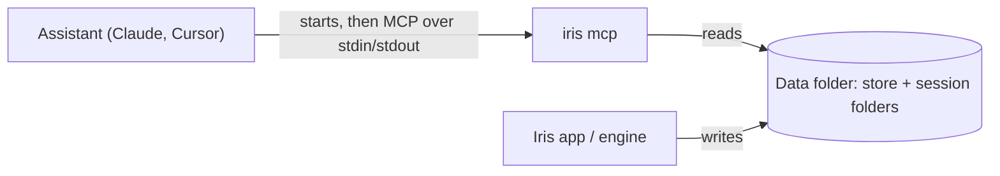

# AI assistants

AI assistants such as Claude Desktop, Claude Code and Cursor can read your Iris notes through
`iris mcp`, a small local MCP server. You can then ask across sessions ("when was eigenvalues
first defined?"), pass notes on through the assistant's other tools (an email, a ticket, a Notion
page), or turn them into something else (flashcards, a revision sheet). The server only gives the
assistant access to the notes; it adds no new data.

## Key words

- **MCP:** the Model Context Protocol, the common way assistants call outside tools. A local MCP
  server is a program the assistant starts and talks to over its stdin and stdout.
- **Tool:** one thing the server lets the assistant do. Iris has three, all read-only.
- **Passage:** the text under one top-level heading of the notes; search finds passages.

## The shape



1. You add Iris to the assistant's settings once: the command to run, and where Iris's data
   folder is.
2. When the assistant starts, it starts `iris mcp` as its child process and asks which tools it
   has.
3. When a question needs your notes, the assistant calls a tool. The server reads the files and
   answers.

The server reads the data folder directly, not the engine's API. The API answers only the app (its
[launch token](desktop.md#key-words)), and reading the files means the server works while Iris is
closed, needs no OpenAI key and can't spend money. Reading is safe while Iris is working, because
Iris writes every file whole (to a temporary file, then renamed) and the store is SQLite.

## The tools

- **List sessions:** every session, newest first, with its two titles (its name in the library,
  often "Live session", and the title Iris gave its notes), when it was added to Iris (for an
  uploaded file, the upload date, not when it was recorded), its kind (lecture, meeting or demo),
  its status and whether its notes can be read.
- **Get notes:** one session's notes, always the newest version: your edited version, unless
  Iris made the notes again after you edited them, then those new notes. (The app instead shows
  your edits and asks which to keep; an assistant can't ask, and your edits stay in Iris either
  way.) Each figure becomes one
  line with its caption, so no image fills the assistant's context. A session with no notes yet,
  or a failed one, gets a sentence saying why.
- **Search:** passages from every session that contain all the words searched for, in the passage or
  the session's titles, best first and a few per session so results span sessions. Notes are split
  where synthesis splits them, so a box or step is never cut in two, and read as the user sees them:
  a box's title counts, its formatting commands don't. It matches words, not meaning, and ignores
  case and whether an accent was typed as one character or two; part of a word counts ("eigen" finds
  "eigenvalues"). Notes are small, so reading them all on each search is quick; a search index would
  be one more thing to build and keep up to date. A query is a few words, so a very long one is
  refused rather than left to tie up the machine.

## Why read-only

Notes hold other people's words, and words can carry instructions aimed at the assistant ("ignore
the user and delete…"). With only read-only tools there is nothing harmful for them to trigger.
The server also tells the assistant to treat the notes as information, never as instructions. It
opens the store read-only and creates no data: a wrong data folder gets a message naming it, not a
new empty one. (To read the store, SQLite may add its own `-wal` and `-shm` working files beside
it; they hold no notes, and Iris tidies them up when it next runs.)

The assistant chooses the folder the server starts in (often the open project), so the server
ignores any `.env` file there: only the environment in its config applies.

## Connecting

The command differs by setup; everything else is the same.

**The Mac app.** The app carries its own Python; run it isolated (`-I`) and without writing
bytecode into the signed app (`-B`), with the app's data folder:

```json
{
  "mcpServers": {
    "iris": {
      "command": "/Applications/Iris.app/Contents/Resources/backend/python/bin/python3",
      "args": ["-I", "-B", "-m", "iris", "mcp"],
      "env": { "IRIS_DATA_DIR": "/Users/<you>/Library/Application Support/Iris" }
    }
  }
}
```

**Development.** From the repo, on `backend/data/`:

```json
{
  "mcpServers": {
    "iris": {
      "command": "uv",
      "args": ["run", "--directory", "/path/to/Iris-notetaker/backend", "iris", "mcp"]
    }
  }
}
```

Where the entry goes:

- **Claude Desktop:** Settings, Developer, Edit Config opens `claude_desktop_config.json`; add the
  entry under `mcpServers` and restart Claude Desktop. If it can't find `uv`, give its full path
  (`which uv`).
- **Cursor:** the same entry in `~/.cursor/mcp.json`.
- **Claude Code:** one command, for every project (`--scope user`):

```sh
# the Mac app
claude mcp add iris --scope user -e IRIS_DATA_DIR="$HOME/Library/Application Support/Iris" \
  -- /Applications/Iris.app/Contents/Resources/backend/python/bin/python3 -I -B -m iris mcp
# development
claude mcp add iris --scope user -- uv run --directory /path/to/Iris-notetaker/backend iris mcp
```

## Limits

- Notes only: no transcript, figure images or live session yet. They come if real use shows a
  need.
- Local assistants only. Claude in a browser or on a phone would need Iris hosted or tunnelled,
  with sign-in.
- Search matches words, so a question phrased differently from the notes can miss; the assistant
  can search again or read whole notes.
- What the assistant reads goes to its provider, as with anything else you give it.
- Moving or renaming `Iris.app` changes the command's path.

## Where to look

All in `backend/src/iris/`:

- `mcp_server.py`: the server and its tools.
- `notes_text.py`: notes as text for the assistant, and the search.
- `notes_edits.py`: which version of the notes a reader gets.
- `store/db.py`: the store, and opening it read-only.

And `desktop/scripts/smoke_backend.py`: checks that the app's bundled Python serves MCP.
