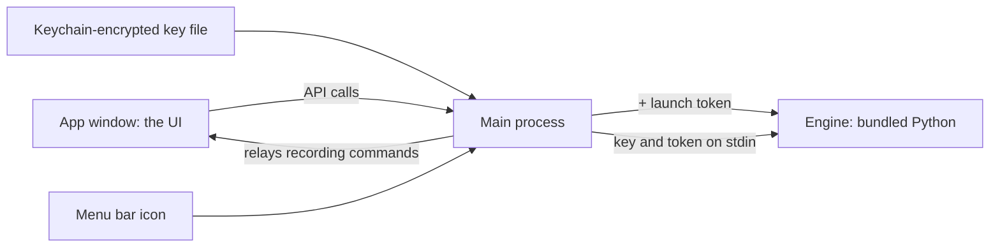
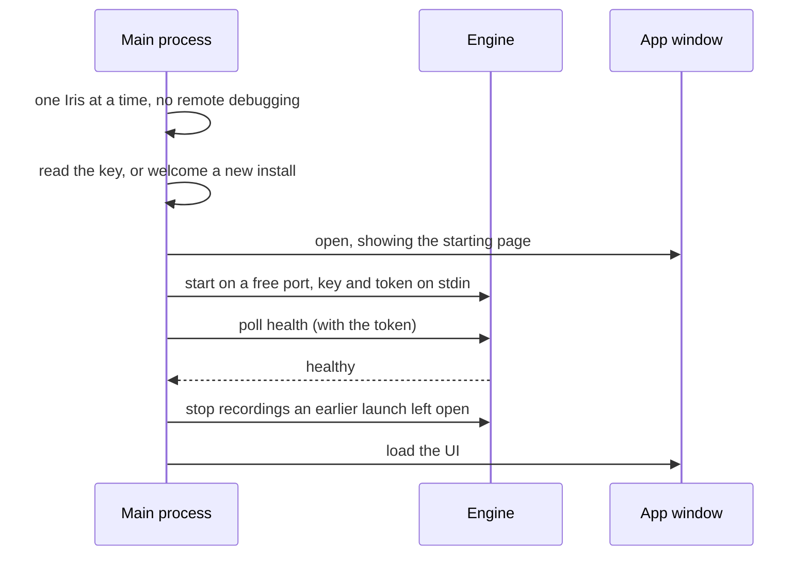

# Desktop app

`Iris.app` is Iris for macOS (Apple Silicon) with no terminal or repo: Electron shows the web UI
in an app window and runs the [engine](overview.md#key-words) as its child process. It adds what a
browser can't do well: recording any screen or window with the Mac's sound, a menu bar icon, and
keeping the OpenAI key safe.

## Key words

- **Main process:** the app's Node side. It owns the windows, starts the engine and answers
  every request the app window makes.
- **App window:** the page showing the Iris UI. It runs sandboxed, with no Node, and reaches the
  app only through a small [bridge](ui.md#key-words).
- **App handler:** how the app window gets everything, over Iris's own `app://` address: the
  built UI, and API calls forwarded to the engine.
- **Launch token:** a random secret made at each engine start. The app handler adds it to every
  forwarded request, so the engine answers only the app. The page never sees it.
- **Key window:** where the OpenAI key is entered and checked with OpenAI before it is saved.
- **Picker:** Iris's own chooser of a screen or window to record.
- **Fuses:** switches baked into the Electron binary at build time that turn off ways of running
  other code inside Iris.

## The shape

The main process sits between everything: the window only ever talks to it, and only it talks to
the engine. The UI inside the window is the same code as in a browser
([`ui.md`](ui.md)); recording works as described in [`recording-live.md`](recording-live.md).

**Why Electron, not the system WebView (Tauri):** the WebView's screen and system-audio capture
is weak, and capture is Iris's core.

## Starting up

1. A second launch only focuses the Iris already running.
2. The key is decrypted once per launch. On a new install's first launch the app welcomes the
   user and opens the key window; the key can also be set up later, and Iris opens without one.
3. The app window opens at once with a small starting page, so the user sees Iris while the
   engine starts; the UI loads as soon as the engine answers its health check.
4. On the first start of a launch, recordings a crash or forced quit left open are stopped
   (kept, never turned into notes) before the UI loads.

*Why the starting page:* the first launch of a new copy can be slow while macOS checks the
bundled libraries; a blank window would look broken.

## The app handler

1. The window loads `app://iris/`. A path that names a file in the built UI is served from it; a
   path without one (a client-side route after a reload) gets the UI's start page, so deep links
   work; anything else is refused.
2. `app://iris/api/…` is forwarded to the engine on `127.0.0.1`, with the launch token added.
   Only the path and query are taken from the request, so a crafted URL can't change where it
   goes.
3. Requests and responses are streamed both ways, so a large upload is piped through, never held
   in memory, and the progress stream arrives event by event.
4. While the engine is down, the handler answers for it, so the UI still loads and its pages say
   Iris isn't responding.

*Why:* the engine stays an engine and never serves a client's files, and the page needs no token
or port. The token is added in the handler, not the page, because the progress stream and images
are fetched by the browser itself and can't carry it.

## The key

1. The key window takes the key, checks its form, then makes one free request to OpenAI to
   check that the key works; a rejected key or no connection is said there, and nothing is saved.
2. The key is stored encrypted with Electron's `safeStorage`, whose own key the macOS Keychain
   holds ("Iris Safe Storage"). It is never written in plain text, logged, or sent to a page.
3. At each engine start the key and the launch token go to the engine as one line on its stdin.
4. Changing or removing the key restarts the engine, so it is refused while a session is
   recording or making notes.

*Why stdin:* any process of the same user can read another's environment with `ps`, but only the
engine reads its own stdin. *Why check first:* a wrong key fails where it is typed, not in the
first session.

## Capture and the picker

1. The Live page asks for the screen with the browser's own call. The main process answers it
   with Iris's picker: the entire screen first, then app windows, never Iris's own.
2. A request for sound alone gets the Mac's sound with no picker; it needs no Screen Recording
   permission, only System Audio Recording.
3. Choosing a window brings its app to the front, so the user lands on what they are recording.
4. Without the Screen Recording permission macOS lists nothing, so the picker explains how to
   allow it.

*Why Iris's own picker:* it can offer the entire screen first, which keeps recording whichever
app the user switches to, and leave out Iris's own windows, which recording never wants.

## The menu bar

1. The menu bar icon starts, pauses and continues a recording, and makes its notes, from any
   app, with the window hidden or closed.
2. It doesn't record itself: it relays commands to the Live page, which records, and shows what
   the page reports.

*Why relay:* one recorder, in the page, for the browser and the app alike.

## Quitting and crashes

1. Closing the window doesn't quit: Iris keeps running, and making notes, in the Dock and menu bar.
   While a recording is open, closing only hides the window, since closing would end the
   recording; the menu bar or the Dock brings it back.
2. Quitting while a session is recording or making notes asks first. Iris then stops its
   recordings (kept), then the engine, then exits ([`recording-live.md`](recording-live.md)).
3. If the engine dies, the app offers to restart it; the window stays loaded and its uploads
   retry until the engine is back.
4. If the window's page crashes, its recordings are stopped and the page reloads; if it keeps
   crashing, the app asks whether to reload or quit.
5. The engine watches the app's process and exits when it is gone, so a killed app leaves no
   engine behind.

## Security

- **Windows** are sandboxed, with no Node. They may load only Iris's own pages; links open in the
  browser, and new windows are refused except a session's figure opened full size.
- **Permissions:** only media capture (the mic or a camera; the UI only ever asks for the mic)
  and screen capture, only for the Iris UI.
- **The bridge** gives the UI a few actions and nothing to read, and the main process accepts
  them only from the main window showing the UI.
- **Fuses** turn off running Iris as plain Node, `NODE_OPTIONS`, `--inspect` and loading code
  from outside its signed `app.asar`; the packaged app quits at once if started with remote
  debugging.
- **No developer tools** in the packaged app: from them, whoever is at the keyboard could call
  the engine through the window with the token added. The dev app keeps them.
- **The hardened runtime** has macOS refuse a debugger attaching to the app or its engine, and
  libraries added to them at launch. Only what Iris needs is let back in: compiling JavaScript as
  it runs, the microphone, and loading its own libraries.

*Why the fuses and the hardened runtime:* anything running as the user could otherwise start Iris
with its own code in it, or reach into it while it runs, and borrow the Keychain's trust in Iris
to read the key. The fuses close Electron's ways in, the hardened runtime the Mac's.

## Packaging

1. `make desktop` builds the UI, then a standalone Python with Iris installed into it, then the
   app and a `.dmg` with electron-builder.
2. The engine runs from that bundled Python, isolated from the user's environment, so nothing has
   to be installed. A smoke test runs the bundle before the build is accepted, and again once it
   is signed inside the app, where the hardened runtime decides what it may load.
3. The engine's code is compiled ahead, in a form that stays valid when the build copies it into
   the app, so the engine starts without compiling it again. The second smoke test runs it in a way
   that would save anything it had to compile, and the signature is checked afterwards: a write
   would break the app's seal, so a passing build proves nothing needed compiling.
4. The app is ad-hoc signed, not notarized, so every build is a new app to macOS
   ([`development.md`](development.md#opening-a-downloaded-copy-of-the-app)).

## Limits

The key protection keeps it from other programs running as the user. It doesn't stop:

- a keylogger or screen reader catching the key as it is typed;
- anything reading the session files in the data folder, which are plain files;
- anything with admin rights, or a process the user lets through the Keychain's own prompt;
- a program that can write into `Iris.app` swapping in a library of its own. macOS only checks
  that an app's libraries come from the same developer when the app is signed with an Apple
  developer certificate; an ad-hoc or self-signed app has no developer to check against, so that
  check is off.

## Where to look

- `desktop/main.cjs`: the wiring: windows, the engine, menus, capture, quitting.
- `desktop/src/`: the main process's parts, each tested in `desktop/test/`; the decisions
  (`routes.cjs`, `policy.cjs`, `tray.cjs`, `picker.cjs`) are pure functions.
- `desktop/pages/`: the starting page, the key window and the picker, with their preloads.
- `desktop/electron-builder.yml`: packaging, signing, the fuses and the hardened runtime, with its
  entitlements in `desktop/build-resources/`.
- `desktop/scripts/`: the build, the backend bundle and its smoke test.
- `backend/src/iris/launch_secrets.py`, `parent.py`, `api/token.py`: the engine's side.
