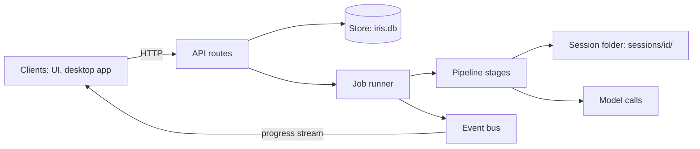
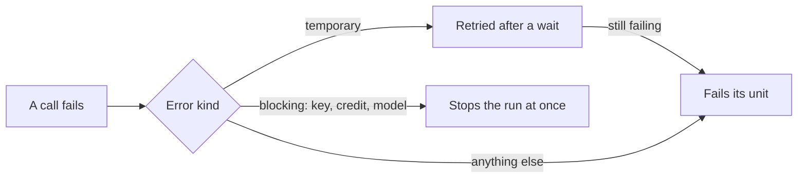

# The engine

The engine is Iris's Python backend: a FastAPI server that stores sessions, runs the pipeline that
turns them into notes, and streams its progress. The web UI and the desktop app reach it over its
API. This page covers the parts every flow shares; the flows themselves are in
[`making-notes.md`](making-notes.md) and [`recording-live.md`](recording-live.md). For the
shared words engine, session, source, stage, pipeline and run, see
[`overview.md`](overview.md#key-words).

## Key words

- **Data folder:** where the store and every session folder live (`backend/data/` in
  development, `~/Library/Application Support/Iris` in the app; see
  [`development.md`](development.md#running)).
- **Session folder:** `sessions/<id>/` in the data folder: the recording, each stage's output and
  caches, the user's edits and the usage log.
- **Store:** a small SQLite database (`iris.db`) of which sessions exist, their status and the
  stage a run reached. The session folder is the truth about content.
- **Unit:** a piece of a stage's work that succeeds or fails alone (a transcription chunk, a
  figure).
- **Cache:** a unit's result saved under a key made from its inputs, model and prompt, so a re-run
  reuses it without paying again.
- **Progress stream:** the events a run sends as it goes, followed by clients as server-sent events.
- **Error kind:** how a failed model call is sorted, for example temporary (retried) or blocking
  (stops the run).
- **Notes edits:** the user's changes, kept beside the generated notes so a re-run never
  overwrites them.

## The map

A route reads the store or the session folder, or asks the job runner to start a run. The
runner runs the stages, which read and write session files and call models, and publishes what
they do as events that clients follow as it happens.

## The session folder and the store

1. A session is made by an upload or the start of a recording: a row in the store and an empty
   session folder.
2. Each stage writes its own files there, all named in one place (`store/layout.py`). Its JSON
   outputs are written atomically (`write_model`), so a crash never leaves one half-written.
3. The store only records what a list needs: the title, the source, the status, the stage a run
   reached, and how a failed run ended. The engine's request threads and its job runner
   share one connection, so the store lets only one query through at a time; two at once would
   mix up their rows.
4. A failure is stored twice: what the user is told (one of a fixed list of messages Iris wrote)
   and, apart from it, the raw error for developers (`iris show`). A stored message that is no
   longer on the list (reworded since, say) is shown as the generic one, never as it is, and
   never stops the list from loading. Older versions stored only the raw error; opening their
   store moves it to the developers' side and gives those sessions the generic message.
5. The user's edits sit beside the generated notes, written only by the API. A re-run makes new
   notes and leaves the edits alone ([`ui.md`](ui.md#reading-and-editing-notes)).
6. The notes or the transcript, asked for before they are made, answer "not ready". When they
   are there but damaged, or the file can't be opened, the full error is logged and the answer
   is a plain "couldn't be read", never a raw error. Damaged edits are passed over and the
   generated notes shown; edits that can't be opened are refused, since they may be intact.
7. Deleting a session removes its row first, so live input or a request for notes arriving
   meanwhile is refused instead of starting work on it again; then its live processing stops,
   and only then does its folder go.
8. A session's name is the user's: the pipeline never sets it, so it stays through re-runs. The
   engine and the UI's name field share one length limit. A Markdown export is named after it:
   the download carries an ASCII version of the name, for clients that only read that, and the
   full name, which browsers prefer, both cleaned of anything that could act as a path or reorder
   the text. Folding the name to ASCII can turn full-width slashes and quotes into real ones, so
   the folded name is cleaned again.

*Why:* files are the source of truth and the store is only an index, so any stage can be run,
checked or re-run from its files alone, and a session survives a crash (principle 4).

### What a session folder holds

A stage's outputs sit beside its cache folders; a cache holds one file per unit, named by its key.
Promotion is a live recording's results kept as the stages' own
([`recording-live.md`](recording-live.md#making-notes-and-promotion)).

| File or folder | What it holds | Written by |
| --- | --- | --- |
| `source.<ext>` | the uploaded recording, as sent | the API, on upload |
| `audio.wav` | the sound, as one plain track | ingest |
| `frames/`, `frames.json` | the sampled stills of the screen, and the list of them with their times | ingest; while recording, the screen lane adds stills as they come |
| `transcript_chunks/` | each transcribed chunk (a cache) | transcribe |
| `transcript.json` | what was said, with its times | transcribe, or promotion |
| `moments.json` | the moments found on screen | detect, or promotion |
| `alignment.json` | each moment with the speech around it | align |
| `selection_batches/` | each batch of moments read (a cache) | select, or the select lane |
| `selection.json` | what was read on screen, and the figures kept | select, or promotion |
| `visuals/` | each figure's source crop and its redraw | select (crops) and render (redraws), or the select lane |
| `render_cache/` | each finished redraw (a cache) | render, or the select lane |
| `renders.json` | which picture each figure shows, and whether it was checked | render |
| `notes_sections/` | each written section (a cache) | write, or the draft lane |
| `notes_draft.json` | the notes as written, before the polish | write |
| `synthesis_cache/` | synthesis's plans and rewrites (a cache) | synthesize |
| `notes_synthesis.json` | the notes after synthesis | synthesize |
| `synthesis.json` | what synthesis did, or why it skipped or failed | synthesize |
| `notes.json` | the finished notes | assemble |
| `notes_edits.json` | the user's edited notes, the latest save only | the API, never a stage |
| `usage_calls.jsonl` | one line per model call | the usage log |

A live recording keeps its own files in `live/`:

| File or folder | What it holds | Written by |
| --- | --- | --- |
| `live/audio/` | the audio chunks as they arrived, by number | the API, while recording |
| `live/frames/` | the screen stills as captured, by time and share | the API, while recording |
| `live/audio.pcm` | the chunks decoded so far, as one stream | the audio lane |
| `live/transcript_windows/` | each transcribed window (a cache) | the audio lane |
| `live/select_batches.json` | which moments went into each batch read, so a restarted lane reads the same batches and finds them cached | the select lane |

## Runs and the job runner

1. A run starts after an upload, when notes are asked for on a live recording, or for a re-run,
   which can start from any stage. A session already running can't start another.
2. The runner is an asyncio task inside the server. It works through the stages in order; when
   two run side by side and one fails, the other is cancelled.
3. For a live session, the run first lets the live work ([lanes](recording-live.md#key-words))
   finish, then keeps what they already did and runs only the rest.
4. A re-run from [select](making-notes.md#align-and-select-reading-the-screen) or earlier throws the
   old [notes draft](making-notes.md#key-words) away, so notes are never assembled against figures
   that no longer exist.
5. Each time the engine starts, it marks every session still "processing" as failed: its run was
   cut off by a quit, a restart or a crash. A re-run then resumes from the stage it reached.
   Recordings are left alone: in a browser a recording carries on through a restart, and the
   desktop app stops its own when it starts. A command-line run on the same data while the engine
   starts is marked too, though it carries on; if it finishes, the mark is cleared.

*Why:* one user on one machine needs no queue server or worker process. Cut-off runs are found
at start-up, not at shutdown, because a crash never reaches shutdown code.

## Units and caches

1. Most stages split their work into units: a transcription chunk, a batch of
   [moments](making-notes.md#key-words) to read, a notes section, a figure. Some run many units
   at once (transcription chunks, figures).
2. Each finished unit is saved under a key made from everything it depended on: its inputs, the
   model and the prompt.
3. A re-run computes the same key and finds the result, so it makes no model call and costs
   nothing. A change to the model, the prompt or the input changes the key, so that unit is
   done again.

*Why:* a failure, a crash or a change to one stage then costs only the work that changed, not the
whole session again.

## Model calls and errors

1. Every model call goes through one OpenAI client (`get_openai`). Model IDs come from the
   settings, never from a stage, so changing a model is a setting, not a code change.
2. The client logs each call (its tokens, time and cost) to the session's usage log as it
   finishes, so a session's cost is known while it runs. Logging never fails a call.
3. A failed call is sorted into an error kind, in one place (`llm/errors.py`), so every stage
   sorts errors the same way.

A temporary error is retried after a wait, and fails its unit if it keeps failing; a blocking one
(a missing or invalid key, no credit left, a missing model) stops the run at once. Any other error
fails only its unit: the other units finish and are
cached, then the stage decides what that means. Most fail the run; render shows the figure's
source crop instead ([render](making-notes.md#render-redrawing-the-figures)), and a failed
[synthesis](making-notes.md#key-words), whatever the error, keeps the notes as written. Figures
don't wait to retry: unusable output is tried again with feedback, but any other error on a
figure except a blocking one shows its source crop at once, uncached, so a later run tries the
redraw again.

*Why:* a missing key or a rate limit means the same thing in every stage, so it is decided once.

### Usage and cost

1. The job runner wraps every stage in a record of which session and stage its calls belong to.
   Stages running side by side each keep their own. A stage that makes several kinds of call
   (render's drawings, images and checks) labels each with its purpose.
2. Each call (its tokens, time, cost and any error) is appended to the session's usage log as it
   finishes. The log is the truth: appending costs the same however long the session is, calls
   finishing together never mix their lines, and a crash loses at most the line being written.
   A line cut off that way is skipped when read, and the next call starts a fresh line rather
   than extending it.
3. Cost comes from the price list in the settings: the model's exact ID, else the ID without a
   dated snapshot suffix; nothing else is guessed. A call with no price is recorded as unpriced,
   with the reason, never as free. Images or audio in a call are billed at their own price only
   where the model has one; otherwise they count as ordinary tokens. An image model's output
   with no breakdown counts as image tokens. Audio billed by length is charged per second,
   rounded up. A request with more input tokens than a model's long-context threshold is billed
   at its long-context price.

   The default list is OpenAI's standard-tier
   [pricing page](https://developers.openai.com/api/docs/pricing), kept with the date it was
   checked; the two are updated together. A model the page gives only an estimate for
   (`gpt-transcribe`, per minute) is left out, so its calls show as unpriced. The page lists the
   gpt-4o transcribe models' audio price as plain "Input", so it applies to their text prompt too.
4. Totals per stage, model and purpose are added up from the log each time the API or `iris cost`
   asks, so they are current while a stage runs; no summary is kept beside the log. A re-run that
   only hits its caches makes no calls, so it adds nothing.
5. The session list shows each session's cost from totals kept in memory that read only the
   lines added since the last look, so listing stays cheap however long the logs grow. Only
   complete lines count: one still being written waits for the next look. A log that shrank or
   was replaced is counted again from the start; one that can't be read shows no cost for that
   session instead of breaking the list. A session with no calls yet shows no cost at all, and
   counting never holds up a call being logged.

*Why:* cost is a side note to the work, so recording never fails a call or a stage: an error while
recording is logged and dropped. An append-only log keeps every call even when a run crashes or
several stages log at once.

## The progress stream

1. Stages publish events as they go (a stage started, a moment found, a figure redrawn, the run
   failed) to an in-memory event bus.
2. The bus keeps each session's recent history. A client that connects late, or reconnects,
   first gets that history, then each new event as it happens.
3. Clients follow it as server-sent events.

*Why:* progress only flows from the engine to the client, so server-sent events are enough, and
they pass through the desktop app's forwarding unchanged.

## The Markdown export

1. On request, the engine serves a session's notes (the user's edited version when there is one)
   as one Markdown file that stands alone: each figure becomes its image, carried inside the file,
   followed by its caption.
2. Only images inside the session's folder are carried in. A link to the web, to a file that is
   missing, or to anywhere outside the session is left as written.
3. An SVG redraw is carried in as a PNG drawn from it: Markdown viewers refuse SVG carried that
   way, because SVG can hold script.
4. The text is written out again as standard Markdown, so its layout may be tidied. Maths is set
   aside while that happens and put back after, since rewriting would escape its symbols.
5. The lines that open and close boxes and steps are kept exactly as written; other Markdown apps
   show them as plain text.

*Why:* one file that opens in any Markdown app, with nothing to fetch, is what an export is for.

## Settings

Every option lives in one settings class (`config.py`): the models, how hard they think, limits,
the data folder. Values come from `IRIS_*` environment variables, a `.env` file, and what the
Settings page saved (`settings.json`); which one wins is in
[`development.md`](development.md#settings). The OpenAI key is read as `OPENAI_API_KEY`. In the
desktop app, the key and the [launch token](desktop.md#key-words) arrive on the engine's stdin
instead.

The spoken language defaults to English rather than detection, because detection is unreliable:
`whisper-1` hears some British English as Welsh, and in a live session the first window's guess
carries into the rest through the prompt. A language code Whisper doesn't know (`jp` for `ja`) is
rejected when the settings load or are saved, not on every transcription request.

A change saved on the Settings page applies at once, without restarting the engine: the next
session uses it, and so does a re-run that transcribes again. A re-run that resumes after
transcription keeps the transcript it has, and a session already recording keeps the language its
live transcription started with. Saves go one at a time, so the file and the running settings
agree. The page learns only whether the engine has a key, never the key itself.

## The CLI

The `iris` CLI builds its own store and job runner from the same code, in its own process, on
the data folder, with no server (`serve` starts one; `replay-live` talks to a running one). The
commands are in [`development.md`](development.md#the-cli). `mcp` is the exception: it opens the
store read-only and never runs anything ([`assistants.md`](assistants.md)).

## Limits

- One run per session at a time. A run can't be cancelled from the API, and a session that is
  processing can't be deleted or re-run until it finishes.
- Events live in memory: a restart loses their history, not the state (files and store keep it).
- Only the desktop app sets a [launch token](desktop.md#key-words) (or `IRIS_API_TOKEN` by hand);
  without one (`make dev`, `iris serve`), anything on the machine can call the engine.
- A CLI run uses the data folder but not the engine's runner: if the engine starts while it is
  going, it marks that run as cut off, though the run carries on.

## Where to look

All in `backend/src/iris/`:

- `main.py`: creates the app: the store, the event bus, the runner, the token check.
- `api/routes/`: the routes, by area (sessions, live input, progress, usage, settings).
- `jobs/runner.py`: runs, cut-off runs and how a failure is recorded.
- `store/layout.py`: every file in a session folder, writing files whole (`write_model`), and
  keeping paths inside the session.
- `store/db.py`: the store.
- `notes/edits.py`: which version of the notes a reader gets.
- `notes/export.py`: the Markdown export.
- `events.py`: the event bus.
- `llm/client.py`: the one OpenAI client.
- `llm/errors.py`: error kinds and retries.
- `llm/structured.py`: structured model calls, the check of their replies, and cached answers.
- `llm/transcription.py`: speech model calls.
- `llm/usage.py`: the usage log and cost.
- `config.py`, `user_settings.py`: settings and their precedence.
- `api/token.py`, `launch_secrets.py`, `parent.py`: the desktop app's side of the engine.
- `cli.py`: the `iris` command.
