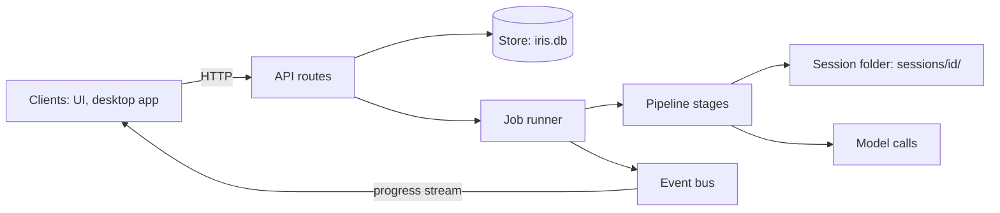
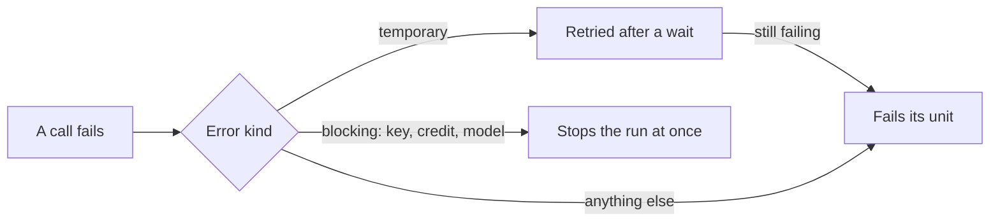

# The engine

The engine is Iris's Python backend: a FastAPI server that stores sessions, runs the pipeline that
turns them into notes, and streams its progress. The web UI and the desktop app reach it over its
API. This page covers the parts every flow shares; the flows themselves are in
[`making-notes.md`](making-notes.md) and [`recording-live.md`](recording-live.md). For the
shared words engine, session, source, stage, pipeline and run, see
[`overview.md`](overview.md#key-words).

## Key words

- **Data folder:** where the store and every session folder live (`backend/data/` in
  development, `~/Library/Application Support/Iris` in the app; see
  [`development.md`](development.md#running)).
- **Session folder:** `sessions/<id>/` in the data folder: the recording, each stage's output and
  caches, the user's edits and the usage log.
- **Store:** a small SQLite database (`iris.db`) of which sessions exist, their status and the
  stage a run reached. The session folder is the truth about content.
- **Unit:** a piece of a stage's work that succeeds or fails alone (a transcription chunk, a
  figure).
- **Cache:** a unit's result saved under a key made from its inputs, model and prompt, so a re-run
  reuses it without paying again.
- **Progress stream:** the events a run sends as it goes, followed by clients as server-sent events.
- **Error kind:** how a failed model call is sorted, for example temporary (retried) or blocking
  (stops the run).
- **Notes edits:** the user's changes, kept beside the generated notes so a re-run never
  overwrites them.

## The map

A route reads the store or the session folder, or asks the job runner to start a run. The
runner runs the stages, which read and write session files and call models, and publishes what
they do as events that clients follow as it happens.

## The session folder and the store

1. A session is made by an upload or the start of a recording: a row in the store and an empty
   session folder.
2. Each stage writes its own files there, all named in one place (`store/layout.py`). Its JSON
   outputs are written atomically (`write_model`), so a crash never leaves one half-written.
3. The store only records what a list needs: the title, the source, the status, the stage a run
   reached, and how a failed run ended.
4. A failure is stored twice: what the user is told (one of a fixed list of messages Iris wrote)
   and, apart from it, the raw error for developers (`iris show`).
5. The user's edits sit beside the generated notes, written only by the API. A re-run makes new
   notes and leaves the edits alone ([`ui.md`](ui.md#reading-and-editing-notes)).

*Why:* files are the source of truth and the store is only an index, so any stage can be run,
checked or re-run from its files alone, and a session survives a crash (principle 4).

## Runs and the job runner

1. A run starts after an upload, when notes are asked for on a live recording, or for a re-run,
   which can start from any stage. A session already running can't start another.
2. The runner is an asyncio task inside the server. It works through the stages in order; when
   two run side by side and one fails, the other is cancelled.
3. For a live session, the run first lets the live work ([lanes](recording-live.md#key-words))
   finish, then keeps what they already did and runs only the rest.
4. A re-run from [select](making-notes.md#align-and-select-reading-the-screen) or earlier throws the
   old [notes draft](making-notes.md#key-words) away, so notes are never assembled against figures
   that no longer exist.
5. Each time the engine starts, it marks every session still "processing" as failed: its run was
   cut off by a quit, a restart or a crash. A re-run then resumes from the stage it reached.

*Why:* one user on one machine needs no queue server or worker process. Cut-off runs are found
at start-up, not at shutdown, because a crash never reaches shutdown code.

## Units and caches

1. Most stages split their work into units: a transcription chunk, a batch of
   [moments](making-notes.md#key-words) to read, a notes section, a figure. Some run many units
   at once (transcription chunks, figures).
2. Each finished unit is saved under a key made from everything it depended on: its inputs, the
   model and the prompt.
3. A re-run computes the same key and finds the result, so it makes no model call and costs
   nothing. A change to the model, the prompt or the input changes the key, so that unit is
   done again.

*Why:* a failure, a crash or a change to one stage then costs only the work that changed, not the
whole session again.

## Model calls and errors

1. Every model call goes through one OpenAI client (`get_openai`). Model IDs come from the
   settings, never from a stage, so changing a model is a setting, not a code change.
2. The client logs each call (its tokens, time and cost) to the session's usage log as it
   finishes, so a session's cost is known while it runs. Logging never fails a call.
3. A failed call is sorted into an error kind, in one place (`llm/errors.py`), so every stage
   sorts errors the same way.

A temporary error is retried after a wait, and fails its unit if it keeps failing; a blocking one
(a missing or invalid key, no credit left, a missing model) stops the run at once. Any other error
fails only its unit: the other units finish and are
cached, then the stage decides what that means. Most fail the run; render shows the figure's
source crop instead ([render](making-notes.md#render-redrawing-the-figures)), and a failed
[synthesis](making-notes.md#key-words), whatever the error, keeps the notes as written. Figures
don't wait to retry: unusable output is tried again with feedback, but any other error on a
figure except a blocking one shows its source crop at once, uncached, so a later run tries the
redraw again.

*Why:* a missing key or a rate limit means the same thing in every stage, so it is decided once.

## The progress stream

1. Stages publish events as they go (a stage started, a moment found, a figure redrawn, the run
   failed) to an in-memory event bus.
2. The bus keeps each session's recent history. A client that connects late, or reconnects,
   first gets that history, then each new event as it happens.
3. Clients follow it as server-sent events.

*Why:* progress only flows from the engine to the client, so server-sent events are enough, and
they pass through the desktop app's forwarding unchanged.

## Settings

Every option lives in one settings class (`config.py`): the models, how hard they think, limits,
the data folder. Values come from `IRIS_*` environment variables, a `.env` file, and what the
Settings page saved (`settings.json`); which one wins is in
[`development.md`](development.md#settings). The OpenAI key is read as `OPENAI_API_KEY`. In the
desktop app, the key and the [launch token](desktop.md#key-words) arrive on the engine's stdin
instead.

## The CLI

The `iris` CLI builds its own store and job runner from the same code, in its own process, on
the data folder, with no server (`serve` starts one; `replay-live` talks to a running one). The
commands are in [`development.md`](development.md#the-cli). `mcp` is the exception: it opens the
store read-only and never runs anything ([`assistants.md`](assistants.md)).

## Limits

- One run per session at a time. A run can't be cancelled from the API, and a session that is
  processing can't be deleted or re-run until it finishes.
- Events live in memory: a restart loses their history, not the state (files and store keep it).
- Only the desktop app sets a [launch token](desktop.md#key-words) (or `IRIS_API_TOKEN` by hand);
  without one (`make dev`, `iris serve`), anything on the machine can call the engine.
- A CLI run uses the data folder but not the engine's runner: if the engine starts while it is
  going, it marks that run as cut off, though the run carries on.

## Where to look

All in `backend/src/iris/`:

- `main.py`: creates the app: the store, the event bus, the runner, the token check.
- `api/routes/`: the routes, by area (sessions, live input, progress, usage, settings).
- `jobs/runner.py`: runs, cut-off runs and how a failure is recorded.
- `store/layout.py`: every file in a session folder, and `write_model`.
- `store/db.py`: the store.
- `notes_edits.py`: which version of the notes a reader gets.
- `events.py`: the event bus.
- `llm/client.py`: the one OpenAI client.
- `llm/errors.py`: error kinds and retries.
- `llm/usage.py`: the usage log and cost.
- `config.py`, `user_settings.py`: settings and their precedence.
- `api/token.py`, `launch_secrets.py`, `parent.py`: the desktop app's side of the engine.
- `cli.py`: the `iris` command.
