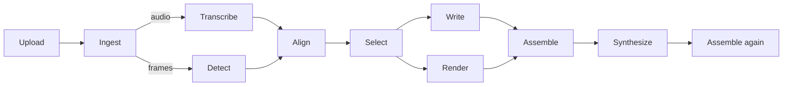
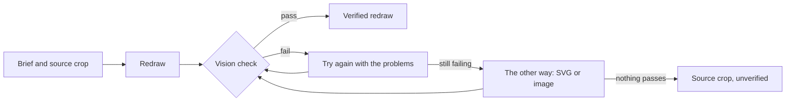

# Making notes

How a recording becomes notes: an upload is decoded into audio and frames, then a fixed series of
[stages](overview.md#key-words) turns them into notes with the screen's content redrawn in them. A
live recording ends in the same stages ([`recording-live.md`](recording-live.md)).

## Key words

- **Ingest:** the first stage: it decodes the source into audio and frames on one clock.
- **Frame:** a still of the screen, sampled at a steady rate.
- **Moment:** a stretch of time where the screen settled on one thing, such as a slide or a
  finished part of a whiteboard.
- **Build:** one addition within a moment, such as a line written or a bullet shown.
- **Element:** one piece of on-screen content read by the vision model: maths, text, a table, code
  or a figure.
- **Figure:** a picture from the screen that the notes show (a `Visual` in the code). It starts
  from its **source crop** (the part of the frame it was cut from, kept on disk) and its
  **brief** (a caption and a full description, every label and value), and shows its verified
  redraw, or else the source crop.
- **Redraw:** a new drawing of a figure, as SVG or a generated image; it is **verified** once a
  vision check passes. A figure already clean on screen keeps its source crop, with no redraw.
- **Section:** a part of the notes written by one model call, in time order. The sections together
  are the **notes draft**, with a marker wherever a figure goes; the figures replace the markers
  at the end.
- **Synthesis:** the final polish: one pass over the whole notes that joins what sections split
  and removes repeats.
- **Notes format:** Markdown plus a few commands (boxes, steps, figures).

## The map

Transcribe and detect run side by side, and so do write and render: write needs only the figures'
briefs, not their images. Every stage writes its output to the session folder, so a re-run
resumes from the stage it reached (principle 4).

## Upload and ingest

1. The uploaded file is saved in a new session folder, and a run starts.
2. Ingest opens it with PyAV (which bundles FFmpeg, so nothing has to be installed) and puts audio
   and video on one clock, starting at the recording's start.
3. The audio becomes one mono WAV file. The video becomes frames, taken at a steady rate and saved
   as JPEGs, with an index of when each was taken.
4. A file with no audio, or one that can't be decoded, stops the run with a message saying what to
   fix; trying again won't help.

*Why:* every source, upload or live, ends as the same audio and frames, so the stages after ingest
are written once and never ask where a recording came from (principle 2).

## Transcribe: the speech

1. The audio is cut into transcription chunks, each cut placed at the quietest point near where it
   should fall, so no word is split in half. How long a chunk is depends on the speech model
   in the settings: `whisper-1`, which times each line, gets long chunks; the others get short
   chunks, so the times stay close even where a model times a chunk's text as one span.
2. The chunks go to the speech model in parallel. Each finished chunk is cached, so a re-run never
   pays for it again.
3. Each chunk's times are moved to the session's clock, and everything is merged into one
   transcript, in order.

*Why:* chunks keep each call bounded and let a failure cost one chunk, not the whole recording.

## Detect: what was shown

Detect watches the frames and decides when the screen settled on something new. It runs on the
machine with OpenCV and makes no model calls.

1. Each frame is shrunk and blurred, so camera noise and compression don't count as change, and
   small changes (a cursor, a blinking caret, a clock) are ignored.
2. Parts of the screen that keep changing, such as a call's video tiles or an embedded video, are
   masked out.
3. A new picture only counts once it holds still for a moment. Animations and slide transitions
   never do, so they are never picked.
4. If the new picture only adds to the old one (a bullet appears, a stroke is drawn), it is a
   **build** of the same moment. A scroll is a build too only while nearly all the earlier content
   stays in view; a larger scroll starts a new **moment**, as does anything else
   (a new slide, a switch of app).
5. A quick flash to something else and back, such as a menu or a peek at another slide, is thrown
   away.
6. Each moment keeps its sharpest frame and its builds in order. (A live recording's shares are
   handled in [`recording-live.md`](recording-live.md).)

*Why:* this is free local work, so the paid model calls only see the few moments worth reading
(principle 3). Builds keep the order things were written in, so a worked example can be written
up step by step.

## Align and select: reading the screen

1. **Align** gives each moment the speech said while it was on screen.
2. **Select** sends the moments to a vision model in small batches, each with its frame, its
   builds (when and where each addition appeared) and its speech. A short summary of what earlier
   batches already captured goes along, so nothing is listed twice.
3. For each moment the model decides whether it is worth keeping. Blank screens, talking heads,
   desktops, menus and loading screens are dropped.
4. A kept moment is read into elements in reading order: maths as LaTeX, text and tables as
   Markdown, code exactly as shown, and figures. Handwriting is read with the speech's help.
5. Each on-screen figure becomes a figure for the notes: the region it covers is cropped from the
   frame (the source crop), and the model writes its brief and chooses how to redraw it: SVG for
   diagrams where exact values matter, an image for real things and scenes, or the source crop
   itself when the screen is already clean or too detailed to redraw safely.
6. The model's answer is checked against what was asked: every moment decided exactly once, and
   every figure given a caption and a way to redraw it; an answer that doesn't fit is refused
   whole. A crop that falls outside the frame is replaced by the whole frame, never cut short.
   Each batch's result is cached.

*Why:* the model sees the speech next to the screen, so it can resolve a smudged symbol or an
abbreviation from what was said. Reading in batches keeps each call bounded on a long session.

## Write: the notes

1. The speech and the screen content are merged into one timeline and cut into parts that each
   fit one model call. Where a part ends depends only on what came before it, never on what comes
   later, so a live session cuts the same parts while recording as an upload does afterwards.
2. Each part is written as one section, in the style the content calls for: a meeting gets
   decisions and action items, a lecture concepts and examples, a demo the workflow. Anything
   unfolding in stages, such as a worked example, is written step by step.
3. Each section must keep the session's title and type and place each of its figures exactly
   once; an answer naming a figure it wasn't given is refused. Small slips the format can fix
   without guessing are repaired; anything else fails.
4. Each finished section is cached and the notes draft is saved as it grows.

*Why:* writing forwards in bounded sections keeps every call small and cacheable, and lets a live
session write most of its notes before it ends. What forward writing can't see (a slide shown
twice, a point split across sections) is left for synthesis.

## Render: redrawing the figures

1. Each figure is redrawn the way select chose: a reasoning model writes SVG, or an image model
   draws from the brief. A figure chosen as the source crop is used as is.
2. A vision model checks every redraw against the source crop and the brief: are the labels,
   values and parts all there and right?
3. A failed check, or unusable output (an invalid SVG, a refusal), is tried again with the
   problems as feedback, then the other way is tried.
4. If nothing passes, the source crop is shown, recorded as unverified. Any other error on a figure,
   even a temporary one, gives the source crop at once (uncached, so a later run tries again);
   a blocking error (such as a missing key) stops the run.

*Why:* a wrong redraw is worse than a screenshot (principle 1). Source crops stay on disk, so any
figure can be checked or redrawn later.

## Assemble and synthesize: the finished notes

1. **Assemble** replaces each marker with a figure line for that figure, pointing at its redraw
   or its source crop. A marker for an unknown figure is dropped, and each figure appears once.
2. **Synthesize** reads the notes whole. First, without any model call, it compares the moments'
   frames and the figures' crops to spot likely repeats (going back to an earlier slide, the same
   figure picked twice).
3. Notes written in one part are left as they are, unless two figures look the same: the writer
   already saw everything. Notes too long for one planning call are left as they are too.
4. Otherwise one model call plans edits: merge a topic split across sections, fix a point the
   speaker later corrected, drop a repeated point, drop a duplicate figure (the only edit allowed
   for notes written in one part). A figure is only dropped if the comparison and the model
   agree; edits naming unknown sections or figures are dropped.
5. Only the sections an edit touches are rewritten. A rewrite is kept only if nothing is lost: no
   figure, maths, decision or action item.
6. Assemble runs again on the result. If synthesis fails, or its edits no longer match the notes
   draft (a re-run of an earlier stage changed it), the notes as written are used.

*Why:* synthesis is a polish, so it may only improve the notes, never lose a figure's content or a
fact that isn't kept elsewhere, and never stop a session from finishing.

## Model output is untrusted

Every model answer is checked against its type before it is used. Select and write refuse an
answer naming moments or figures they weren't given; assemble and synthesis drop unknown ids.
Every model-written SVG goes through `sanitize_svg`. Prompts treat what was said and shown as
data, never as instructions.

## Limits

- Only what settles on screen is seen: an animation or a screen shown very briefly never becomes a
  moment.
- Silence sent to the speech model can come back as made-up lines (issue #45).
- The notes' text isn't checked against the transcript, the way figures are against the screen.

## Where to look

- `backend/src/iris/sources/`: the sources and their ingest (`upload.py`, `browser_live.py`)
- `backend/src/iris/pipeline/__init__.py`: `PLAN`, the stage order
- `backend/src/iris/pipeline/stages/`: one module per stage; its docstring goes deeper
- `backend/src/iris/models.py`: every stage's output type
- `backend/src/iris/notes_format.py`: the notes format, its checks and repair (the UI reads it with
  `frontend/src/notes/format.ts`)
- `backend/src/iris/svg.py`: `sanitize_svg`, for every model-written SVG
- `backend/src/iris/export.py`: the Markdown export the engine serves on request, with the figures
  embedded and the user's edits included
