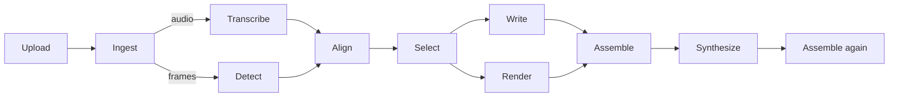
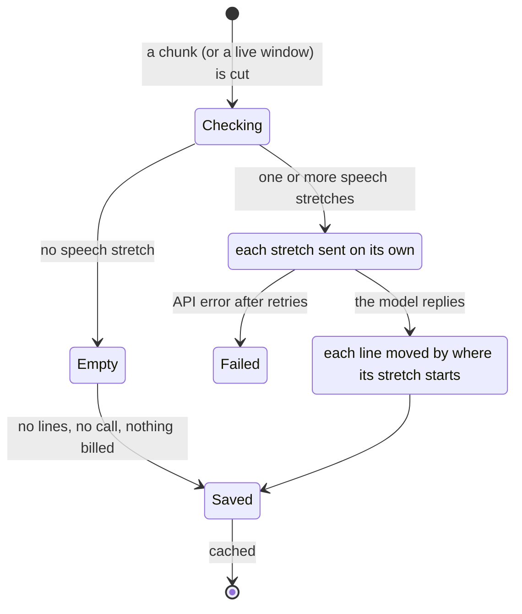
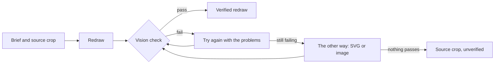

# Making notes

How a recording becomes notes: an upload is decoded into audio and frames, then a fixed series of
[stages](overview.md#key-words) turns them into notes with the screen's content redrawn in them. A
live recording ends in the same stages ([`recording-live.md`](recording-live.md)).

## Key words

- **Ingest:** the first stage: it decodes the source into audio and frames on one clock.
- **Frame:** a still of the screen, sampled at a steady rate.
- **Moment:** a stretch of time where the screen settled on one thing, such as a slide or a
  finished part of a whiteboard.
- **Build:** one addition within a moment, such as a line written or a bullet shown.
- **Element:** one piece of on-screen content read by the vision model: maths, text, a table, code
  or a figure.
- **Figure:** a picture from the screen that the notes show (a `Visual` in the code). It starts
  from its **source crop** (the part of the frame it was cut from, kept on disk) and its
  **brief** (a caption and a full description, every label and value), and shows its verified
  redraw, or else the source crop.
- **Redraw:** a new drawing of a figure, as SVG or a generated image; it is **verified** once a
  vision check passes. A figure already clean on screen keeps its source crop, with no redraw.
- **Section:** a part of the notes written by one model call, in time order. The sections together
  are the **notes draft**, with a marker wherever a figure goes; the figures replace the markers
  at the end.
- **Synthesis:** the final polish: one pass over the whole notes that joins what sections split
  and removes repeats.
- **Notes format:** Markdown plus a few commands (boxes, steps, figures).

## The map

Transcribe and detect run side by side, and so do write and render: write needs only the figures'
briefs, not their images. Every stage writes its output to the session folder, so a re-run
resumes from the stage it reached (principle 4).

## Upload and ingest

1. The uploaded file is saved in a new session folder, and a run starts.
2. Ingest opens it with PyAV (which bundles FFmpeg, so nothing has to be installed) and puts audio
   and video on one clock, starting at the recording's start. Audio that starts later than the
   video is led in with silence, so the two stay on that clock. Audio and video are decoded side
   by side.
3. The audio becomes one mono WAV file. The video becomes frames, taken at a steady rate and saved
   as JPEGs, with an index of when each was taken.
4. Frames are picked by their timestamps on a steady grid, not by counting frames, so a variable
   frame rate or a gap in the video can't shift them; a frame stamped a hair early by rounding
   still counts for its point on the grid. Every frame has to be decoded, but only the ones kept
   are scaled and saved, which is where the cost would be. Each is scaled down (never up) to a set
   width and then turned the way the file says it is shown, since turning the smaller picture is
   cheaper; all of them take the first one's size.
5. The frame index is the proof the frames are complete: it is removed before old frames are
   cleared and written last, so whenever it exists, every frame it lists is on disk.
6. A file with no audio, or one that can't be decoded, stops the run with a message saying what to
   fix; trying again won't help. A file with no audio is refused before any video is decoded.

*Why:* every source, upload or live, ends as the same audio and frames, so the stages after ingest
are written once and never ask where a recording came from (principle 2). A live recording's
frames are picked, sized and saved by the same code, so they match what ingest would make
([`recording-live.md`](recording-live.md#ingesting-a-recording)).

## Transcribe: the speech

1. The audio is cut into transcription chunks, each cut placed at the quietest point near where it
   should fall, so no word is split in half. A pause within 3 dB of the quietest one counts as
   just as quiet, and of those the one nearest where the cut should fall wins. How long a chunk
   is depends on the speech model in the settings: `whisper-1`, which times each line, gets long
   chunks, which give it more context; the others get short chunks, so the times stay close even
   where a model times a chunk's text as one span. No chunk is longer than the speech model
   accepts in one upload.
2. Only the speech in each chunk is sent. A small voice detector bundled with Iris (Silero VAD)
   finds the stretches where someone is talking, and each stretch is sent on its own; a chunk
   with no speech isn't sent at all. Speech is looked for one chunk at a time, so the first
   chunk's stretches are already on their way while later chunks are still being checked.
3. The stretches go to the speech model in parallel. Each finished chunk is cached, so a re-run
   never pays for it again; a cached chunk is used again only while its audio, the model and the
   language asked for are all the same.
4. Each line's times are moved by where its stretch starts, onto the session's clock, and
   everything is merged into one transcript, in order.

*Why:* chunks keep each call bounded and let a failure cost one chunk, not the whole recording.

### Asking each model

Only `whisper-1` times each line, so it is asked for timed lines. A model that tells speakers apart
(a `-diarize` one) is asked for lines with a speaker each; its speaker labels hold within one
stretch only. Any other model is asked for plain text, which becomes one line spanning the
stretch. The reply is read by what comes back, not by the model's name, and each line's times are
kept within its stretch. The language is sent when the settings name one; otherwise the model
detects it.

Only `whisper-1` is given the text said just before (a live recording sends it, an upload
doesn't): it reads it as what came before the audio. The other models read it as instructions,
and what was said in a session is never sent as instructions.

### Sending only speech

The speech model makes up text over audio with no speech in it: over silence, room noise or
clicks it writes lines like "Thank you for watching", or repeats the sentence before. Its own
"was this speech?" scores don't catch these lines, because it writes them confidently. So the
silence never reaches it, which is also how faster-whisper, whisper.cpp and WhisperX handle it.

Two questions decide what is sent, and each follows a tool's published defaults rather than a
number tuned here:

- **Is this speech?** The detector scores every 32 ms. Speech starts at a score of one half and
  ends once the score stays low for a tenth of a second; anything a quarter of a second long or
  less is dropped (Silero's own rule). A click can fool it for a moment, never that long.
- **What is cut out?** Only gaps of two seconds or more between speech, and each stretch keeps 0.4 s
  either side (faster-whisper's settings), so the speech keeps its natural pauses and no word
  loses its edges.

Each stretch is sent on its own rather than joined into one clip. The model's line times are
loose (a line often ends where the next begins), and in a joined clip a loose end could slide over
a join into speech said much later, attaching the line to whatever was on screen then. On its own,
a stretch's lines can only be placed within it: a line 2 s into a stretch that starts at 70 s is
at 72 s. Quiet stretches aren't billed either.

## Detect: what was shown

Detect watches the frames and decides when the screen settled on something new. It runs on the
machine with OpenCV and makes no model calls.

1. Each frame is shrunk and blurred, so camera noise and compression don't count as change, and
   small changes (a cursor, a blinking caret, a clock) are ignored.
2. Parts of the screen that keep changing (about five frames in a row), such as a call's video
   tiles or an embedded video, are masked out, unless the mask would cover most of the screen:
   that is a scroll or a new screen, not a widget.
3. A new picture only counts once it holds still for a moment. Animations and slide transitions
   never do, so they are never picked.
4. If the new picture only adds to the old one (a bullet appears, a stroke is drawn), it is a
   **build** of the same moment. A scroll is a build too only while nearly all the earlier content
   stays in view; a larger scroll starts a new **moment**, as does anything else
   (a new slide, a switch of app). When matching a scroll, parts that stay still (a toolbar) are
   ignored, and content scrolled off screen counts as lost. A new moment records where the screen
   changed from the one before, unless the change covers most of it.
5. A quick flash to something else and back, such as a menu or a peek at another slide, is thrown
   away.
6. Each moment keeps its sharpest frame of the latest settled picture, and its builds in order. A
   frame taken while something new is moving on screen is never the one kept. If nothing ever
   settles, the last moment still gets a real frame, for select to judge. An unreadable frame is
   skipped. (A live recording's shares are handled in [`recording-live.md`](recording-live.md).)

*Why:* this is free local work, so the paid model calls only see the few moments worth reading
(principle 3). Builds keep the order things were written in, so a worked example can be written
up step by step. Scene-cut tools only mark cuts: they can't tell a settled screen from a
transition, or a build from a new slide, so detect is its own small state machine on OpenCV.

## Align and select: reading the screen

1. **Align** gives each moment the speech said while it was on screen.
2. **Select** sends the moments to a vision model in small batches, each with its frame, its
   builds (when and where each addition appeared) and its speech. A short summary of what earlier
   batches already captured goes along, so nothing is listed twice. The speech sent with a batch
   has a size limit: speech longer than that is sampled from its start, middle and end, so one
   screen left up through a long talk can't make a call too big.
3. For each moment the model decides whether it is worth keeping. Blank screens, talking heads,
   desktops, menus and loading screens are dropped.
4. A kept moment is read into elements in reading order: maths as LaTeX, text and tables as
   Markdown, code exactly as shown, and figures. Handwriting is read with the speech's help.
5. Each on-screen figure becomes a figure for the notes: the region it covers is cropped from the
   frame (the source crop), and the model writes its brief and chooses how to redraw it: SVG for
   diagrams where exact values matter, an image for real things and scenes, or the source crop
   itself when the screen is already clean or too detailed to redraw safely.
6. The model's answer is checked against what was asked: every moment decided exactly once, and
   every figure given a caption and a way to redraw it; an answer that doesn't fit is refused
   whole. A crop that falls outside the frame is replaced by the whole frame, never cut short.
   Each batch's result is cached under everything about its moments, not only what was sent, so
   a change to speech left out of the sample still reads the batch again.
7. A session where nothing settled on screen still gets a selection, an empty one, with no model
   call.

*Why:* the model sees the speech next to the screen, so it can resolve a smudged symbol or an
abbreviation from what was said. Reading in batches keeps each call bounded on a long session.

## Write: the notes

1. The speech and the screen content are merged into one timeline and cut into parts that each
   fit one model call. Where a part ends depends only on what came before it, never on what comes
   later, so a live session cuts the same parts while recording as an upload does afterwards.
   A part ends between moments where it can, rather than in the middle of one, as long as it is
   still at least half full. Speech too long for one part is split into pieces that keep its
   original times, never made-up ones; nothing said or shown is dropped.
2. With no speech and nothing read from the screen, there is nothing to write up, and the run
   stops saying so.
3. Each part is written as one section, in the style the content calls for: a meeting gets
   decisions and action items, a lecture concepts and examples, a demo the workflow. Anything
   unfolding in stages, such as a worked example, is written step by step.
4. Each section must keep the session's title and type and place each of its figures exactly
   once; an answer naming a figure it wasn't given is refused. A figure that belongs to a step is
   placed inside the step, at its end. Small slips the format can fix without guessing are
   repaired; anything else fails.
5. Each finished section is cached and the notes draft is saved as it grows. A section's cache
   entry depends only on its own evidence, whether parts come before and after it, the language
   and the first section's title and type, never on how many parts there are, so a section
   written live is found again when notes are made.

*Why:* writing forwards in bounded sections keeps every call small and cacheable, and lets a live
session write most of its notes before it ends. What forward writing can't see (a slide shown
twice, a point split across sections) is left for synthesis.

## Render: redrawing the figures

1. Each figure is redrawn the way select chose: a reasoning model writes SVG, or an image model
   draws from the brief. A figure chosen as the source crop is used as is. The image model gets
   the brief alone, not the source crop: given the rough sketch, it stays too close to its
   shapes, drawing plain circles and boxes for real things. The crop is still what its redraw is
   checked against.
2. A vision model checks every redraw against the source crop and the brief: are the labels,
   values and parts all there and right? A check that lists any problem has not passed, whatever
   its yes or no says.
3. A failed check, or unusable output (an invalid SVG, a refusal), is tried again with the
   problems as feedback, then the other way is tried.
4. If nothing passes, the source crop is shown, recorded as unverified. Any other error on a figure,
   even a temporary one, gives the source crop at once (uncached, so a later run tries again);
   a blocking error (such as a missing key) stops the run, and the figures still being redrawn
   are stopped with it.

*Why:* a wrong redraw is worse than a screenshot (principle 1). Source crops stay on disk, so any
figure can be checked or redrawn later.

## Assemble and synthesize: the finished notes

1. **Assemble** replaces each marker with a figure line for that figure, pointing at its redraw
   or its source crop. A marker for an unknown figure is dropped, and each figure appears once. A
   figure is read only at the start of a line, so a marker inside text gets a line of its own. A
   first heading that repeats the title is dropped, since the title is shown above the notes.
2. **Synthesize** reads the notes whole. First, without any model call, it compares the moments'
   frames and the figures' crops to spot likely repeats (going back to an earlier slide, the same
   figure picked twice).
3. Notes written in one part are left as they are, unless two figures look the same: the writer
   already saw everything. Notes too long for one planning call are left as they are too.
4. Otherwise one model call plans edits: merge a topic split across sections, fix a point the
   speaker later corrected, drop a repeated point, drop a duplicate figure (the only edit allowed
   for notes written in one part). A figure is only dropped if the comparison and the model
   agree; edits naming unknown sections or figures are dropped.
5. Only the sections an edit touches are rewritten, in groups of sections that edits connect.
   A rewrite is kept only if nothing is lost: no figure, maths, decision or action item. A group
   whose rewrite fails keeps its sections as written; the other groups still apply. Dropping a
   duplicate figure needs no rewrite: its marker is simply removed.
6. Assemble runs again on the result. If synthesis fails, its result can't be read, or its edits
   no longer match the notes draft (a re-run of an earlier stage changed it), the notes as written
   are used.

*Why:* synthesis is a polish, so it may only improve the notes, never lose a figure's content or a
fact that isn't kept elsewhere, and never stop a session from finishing.

### Spotting repeats

Two pictures count as the same only when three tests agree: their perceptual hashes are close,
small blurred copies of them barely differ on average, and almost none of their points differ
strongly. The last test is what tells apart two slides on one template: different text changes a
few points a lot, not many points a little. Figures are held to stricter limits than slides,
because one added line of working makes a different figure, and two crops of one figure must
also have about the same shape.

Each picture is compared with the first picture of a group, not the last one added, so a slow
build (each stage like the next) doesn't chain its first and last stages together. Figures from
the same moment are never paired: they are separate builds of one screen. A picture that can't
be read is skipped, since the comparison only gives hints.

### What a rewrite may change

A rewritten group is checked before it replaces anything:

- Every figure marker it was given is still there exactly once, on a line of its own, apart from
  the duplicates being dropped. No images or HTML appear, and its boxes and steps are whole, each
  title and colour still somewhere in the notes.
- Its text keeps at least a set share of what it replaces and grows by no more than a set amount,
  so a rewrite can't quietly summarise a section away or pad it.
- Words that mark a decision, an action item, an open question or uncertainty, and checklist
  items, are counted: a rewrite may rephrase around them but never has fewer of them.
- A section dropped only as a repeat may shrink or empty, but by no more than the text of the
  section that keeps the point. A section another edit also rewrites keeps the usual limits, so
  one repeat can't excuse deleting the rest of its group.
- Maths may be dropped only where it still appears elsewhere in the notes.

Two edits could each lean on the other's copy and lose a point from both. So when edits are
planned, a section a dropped repeat relies on is never rewritten by another edit, and a figure
kept by one edit can't be dropped by another. Once all rewrites are in, any equation missing from
the whole notes undoes the latest rewrite that held it, until every equation is back. An edit
whose sections together are too long to rewrite in one call is skipped.

## Model output is untrusted

Every model answer is checked against its type before it is used. Select and write refuse an
answer naming moments or figures they weren't given; assemble and synthesis drop unknown ids.
Figures are numbered, and their files named, in Iris's own order, never from anything the model
wrote. Every model-written SVG goes through `sanitize_svg`. Progress events never carry
model-written text: the problems a check found stay in the figure's render record on disk.
Prompts treat what was said and shown as data, never as instructions.

## Limits

- Only what settles on screen is seen: an animation or a screen shown very briefly never becomes a
  moment.
- Speech the voice detector doesn't hear as speaking, such as singing over music, isn't
  transcribed.
- With the language set to detect itself ("auto"), each stretch of speech is detected on its own,
  so a short remark between long pauses can come back in the wrong language.
- The notes' text isn't checked against the transcript, the way figures are against the screen.

## Where to look

- `backend/src/iris/sources/`: the sources and their ingest (`upload.py`, `browser_live.py`)
- `backend/src/iris/media/`: what the sources and stages share about media: picking, sizing and
  saving frames (`frames.py`), opening a recording's streams (`container.py`), small image steps
  (`images.py`), WAV files, quiet points and the upload limit (`audio.py`), and joining a live
  recording's chunks into one stream (`webm.py`)
- `backend/src/iris/llm/transcription.py`: what each speech model is asked and how its reply is
  read, sending one stretch, and the cached chunk
- `backend/src/iris/pipeline/__init__.py`: `PLAN`, the stage order
- `backend/src/iris/pipeline/stages/`: one module per stage
- `backend/src/iris/speech.py`: finding the speech to send
- `backend/src/iris/models.py`: every stage's output type
- `backend/src/iris/notes/format.py`: the notes format, its checks and repair (the UI reads it with
  `frontend/src/notes/format.ts`)
- `backend/src/iris/svg.py`: `sanitize_svg`, for every model-written SVG
- `backend/src/iris/notes/export.py`: the Markdown export the engine serves on request, with the figures
  embedded and the user's edits included
