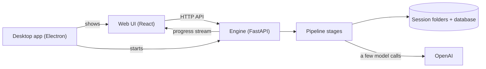

# Overview

Iris turns a session where someone shows things while talking (a lecture, a meeting, a demo) into
notes that keep **what was on screen**, placed next to what was said about it. Audio-only
notetakers lose the slide, the sketch or the diagram the conversation was about; Iris redraws it.
It runs on one person's machine: no accounts, no hosting, the user's own OpenAI key.

## Key words

- **Engine:** the Python backend. It stores sessions, runs the pipeline and serves the API. The
  web UI talks to it over HTTP, in a browser or inside the desktop app.
- **Session:** one recording and everything made from it: audio, frames, transcript, figures,
  notes. Each has a folder on disk and a row in a small database.
- **Source:** where a session's audio and frames come from: an uploaded file or a live recording.
- **Stage:** one step of the pipeline, such as transcribe or render. A stage reads files from the
  session folder and writes its own.
- **Pipeline:** the fixed series of stages that turns a session's recording into notes
  ([`making-notes.md`](making-notes.md)).
- **Run:** one pass of the pipeline over a session, from the first stage or from a chosen one.

## How it works

A session's life:

1. **In:** a file is uploaded ([`making-notes.md`](making-notes.md)), or a recording streams audio
   and frames in as it happens ([`recording-live.md`](recording-live.md)).
2. **Made into notes:** the pipeline finds what changed on screen, transcribes the speech, picks
   what belongs in the notes, writes them and redraws each figure. A live session does most of
   this while it records, so only the rest runs when notes are asked for.
3. **Out:** the notes are read and edited in the UI and exported as a PDF ([`ui.md`](ui.md));
   other clients get Markdown from the API.

## Principles

1. **Professional figures, accurate to the session.** What was shown is rebuilt as a clean figure
   of any kind. A redraw reaches the notes only after a vision model checks it against the crop of
   the screen it came from; otherwise that crop is shown, recorded as unverified. The crop stays
   on disk, so any figure can be checked or redrawn.
2. **One pipeline, many sources.** An upload and a live recording both produce timestamped audio
   and frames; nothing downstream knows which it was.
3. **Local work first, model calls last.** Finding what changed on screen is free OpenCV work on
   the machine. Models only see the few moments that survive it.
4. **Never lose a session.** Every stage writes its output to disk as it goes, and finished work
   is cached. A crash, a closed window or a bad prompt means re-running from the stage the run
   reached, paying only for what wasn't done, never recording again
   ([`engine.md`](engine.md)).
5. **Small and measurable.** Each stage reads files and writes files, so it can be run and tested
   on its own.

## The parts

How it works, in reading order:

| Page | What it covers |
|---|---|
| [`engine.md`](engine.md) | The backend: API, session folder, job runner, model calls |
| [`making-notes.md`](making-notes.md) | An upload becoming notes: the pipeline, stage by stage |
| [`recording-live.md`](recording-live.md) | Recording live, and processing while it records |
| [`ui.md`](ui.md) | The web UI and how it talks to the engine |
| [`desktop.md`](desktop.md) | The macOS app: the window, the key, the engine's lifecycle |

Reference:

| Page | What it covers |
|---|---|
| [`development.md`](development.md) | Setting up, running, checking and debugging |
| [`review-checklist.md`](review-checklist.md) | What a reviewer checks on every branch |

## Limits

Not built yet: Windows and Intel Macs, a signed and auto-updating app for other people, and other
sources such as a meeting bot. Open work is tracked in the GitHub issues.
