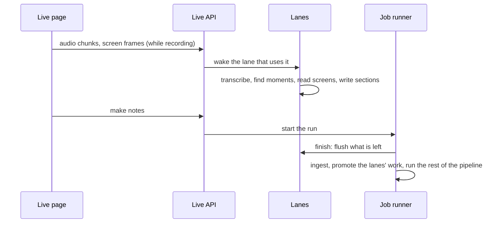
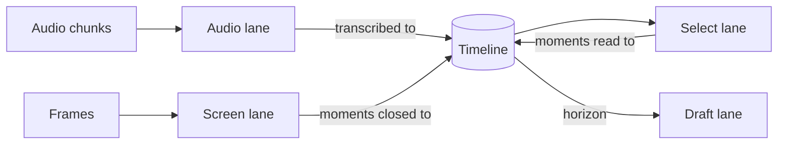

# Recording live

How Iris records a session as it happens, and does most of the note-making while it records,
so the notes are ready soon after the recording ends. The rest of the pipeline is in
[`making-notes.md`](making-notes.md).

## Key words

- **Audio chunk:** a few seconds of audio, posted as it is recorded. The chunks are numbered
  pieces of one WebM stream, so they join back into one recording.
- **Share:** one stretch of screen sharing (any number, or none); each frame carries its number.
- **Lane:** one part of the work done while recording: audio (the transcript), screen (the
  [moments](making-notes.md#key-words)), select (screen content, and redrawing its figures) and
  draft (notes sections). Each runs on its own with the stages' own steps and cache keys.
- **Transcript window:** a stretch of audio the audio lane transcribes in one call, cut at a quiet
  point.
- **Timeline:** where the lanes publish what they have finished, as **watermarks** (how far each
  has got). The **horizon** is the point before which nothing can change any more.
- **Pausing:** capture stops and the devices are let go; the recording can be continued.
- **Stopped:** a recording whose page went away; kept, but it can't be continued (the page held
  the recorder).
- **Make notes:** ending a recording and starting its run.
- **Promotion:** at make notes, the lanes' finished results are written as the stages' own
  outputs, so only what was still open is new work.

## The whole flow

The page captures and sends; the engine stores what arrives and lets the lanes work on it; make
notes turns what the lanes finished into the pipeline's own outputs and runs only the rest.

## Capturing in the page

1. The page opens the microphone and, in the desktop app, the Mac's sound; in a browser, a shared
   tab can bring its own sound. All of it is mixed into **one audio track**, recorded as audio
   chunks.
2. While the screen is shared, the page takes a still of it at a steady rate. Each frame is timed
   on the audio's clock and carries its share's number. With nothing shared, no frames are sent,
   so a recording can be audio only, or share and stop sharing any number of times.
3. Pausing pauses the recorder (its clock too, so the pause isn't in the recording), frames stop,
   and every device is let go. Continuing asks for the devices again and carries on in the same
   recording, under a new share if the screen comes back.
4. If the mic goes away or the recorder fails mid-recording, nothing more can be recorded, so the
   page makes notes from what it has.

*Why:* one mixed track keeps the audio a single recording on one clock, so screen and speech
always line up. Finding what changed on screen happens in the engine, so the page stays simple.

## Sending and storing

1. Chunks and frames go into an upload queue that posts a few at a time and retries a failed post
   with growing waits, through an outage or an engine restart.
2. The engine stores each as it arrives under the session's `live/` folder, keyed by its number
   (a chunk) or its time and share (a frame). A retry of a post that did land, or one that arrives
   out of order, lands in the same place, so nothing is lost or doubled. A post that reuses a
   stored chunk's number, or a frame's time and share, with different content is refused rather
   than written over the recording.
3. Once the recording has ended, any further post is refused, so nothing is added after ingest
   has started. A post's whole body is read first; the check that the recording is still going
   and the write then happen together, with nothing able to run in between, so nothing lands
   once make notes or stop has answered.
4. Make notes waits until the queue is empty and tells the engine how many chunks there were. If
   some never arrived, the engine refuses and lists them; since every post has been answered,
   there is nothing to resend, so the page ends anyway and the missing audio becomes silence of
   the same length. Only the first chunk can't be replaced: it carries the stream's header.

*Why:* the captured files are the recording. The engine never changes them, so a session can
always be ingested again from them, whatever happened to the live work.

## The lanes and the timeline

Each arriving chunk or frame wakes the lane that uses it. The lanes never call each other: each
publishes what it has finished to the timeline and moves its watermark forward, and a lane that
needs another's work waits on that watermark.

- **Audio lane:** decodes the chunks in order as the one stream they are cut from, cuts the audio
  into transcript windows at quiet points (found the same way as an upload's chunk cuts), and
  transcribes them, each with the text before it as context where the model takes it
  ([`making-notes.md`](making-notes.md#asking-each-model)). Only a window's speech is sent,
  exactly as for an upload ([`making-notes.md`](making-notes.md#sending-only-speech)); a window
  with none isn't sent, but still moves "transcribed to" on, so a silence never holds the notes
  back. When the last window finished has no text, the next one sent gets no context, so a
  sentence from before a silence can't be repeated over it. A cut depends only on the audio,
  never on how much had arrived, so a lane restarted after an engine restart makes the same cuts and
  reuses its cached windows. A cut is only made once a little audio past it is decoded, so a pause
  is confirmed, never guessed at the edge of what has arrived; at the end, a last window too short
  to stand alone joins the one before. A missing chunk is waited for a while, then decoding carries
  on after it, the gap stays silence and the lane is marked as having missed input; the first chunk,
  the stream's header, is waited for until notes are made. A few windows are transcribed at once,
  each with the text committed when it is sent, and they commit strictly in order. A cached window
  is reused only if its audio, model, context and language all still match. Every window is sent the
  configured language, so one window misheard as another language can't carry it into the rest; the
  transcript takes its language from the first window with speech.
- **Screen lane:** puts frames in time order, samples and sizes them exactly as ingest will, and
  feeds them to the same moment detector as the detect stage, read back from disk as detect reads
  them. Frames are held back a moment so they can be handled in time order. One that arrives too
  late for that is skipped live; if ingest would use it, the lane is marked as having missed
  input, so its moments aren't kept at make notes. A change of share closes the open moment.
  Before anything is shared, it simply keeps up with the transcript, so it never holds the notes
  back. Once a share has started, its last moment stays open until the next share's frames or
  make notes say where it ended: nothing else can tell sharing having stopped from frames still
  on their way. A restarted lane clears the frames it made and replays every captured one, so
  its output is the same as if it had run all along.
- **Select lane:** waits until the speech around a closed moment is transcribed, a little past its
  end so speech that outlasts the screen is part of it, reads the moments in batches with the
  select stage's own step, and redraws each new figure in the background by the render stage's
  rules. One batch is read at a time and the moments that become ready meanwhile go together into
  the next, so a batch of the same moments after the same content has the select stage's own cache
  key. A few figures are redrawn at once; a redraw that fails gives the source crop, uncached, so
  the render stage tries it again at make notes. The lane notes which moments went into each
  batch, the ones still to come after a restart included, so a lane restarted after an engine
  restart (even twice) waits for the same moments and reads the same, cached, batches, until the
  moments differ or a batch can no longer form. If a lane
  it depends on fails, the redraws still running are cancelled, leaving no half-written cache
  entry. At make notes it reads what is left and waits for the redraws already running; the ones
  not started are left to the render stage, which redraws every figure anyway.
- **Draft lane:** packs everything before the horizon into notes sections exactly as the write
  stage would, and writes each one that can no longer change into the write stage's cache, with
  the input the write stage will give it, so making notes finds it there. A section written live
  always has more after it, and each one after the first is a continuation, even when the first
  could not be written. A section is written again only if its input changed (the language became
  known, say), and the first goes first, since the others carry its title. One that fails is tried
  once more a minute later, then left (at once for a blocking error) until its input changes; the
  write stage tries it again at make notes. While the first waits for its retry the others wait
  too; once it is given up they are written without its title. The Live page's count of sections
  written only goes up, though a rewrite can briefly lower the real count. At make notes a call
  already running finishes, since the write stage would make that very call, but no new one
  starts, not even a retry.

The **horizon** is the earlier of "transcribed to" and "read to": before it, the speech is
transcribed and every moment ending there has been read. Nothing published later can reach back
before it, so notes sections before it are final: screen content is published in the order it was
shown, and the timeline refuses any that starts before what is already read. With no screen
shared no moment can open, so "moments closed to" follows the transcript, and so does the
horizon: the sections are written from the speech alone.

A lane that is done (finished, failed, or not run at all) counts as through any time, so a lane
waiting on it never waits forever. A failed lane isn't a finished one, though: the lanes after it
stop making paid calls and wait for make notes, which redoes their work. A lane not run is never
finished, so nothing waiting on its work is promoted. The draft lane only fills a cache, so its
failure costs nothing at make notes.

*Why:* using the stages' own steps and cache keys makes the live work the final work, not a draft
redone later. Lanes that only talk through the timeline can each fail, restart or wait without
the others knowing; a lane whose input lane failed stops making paid calls.

## Making notes and promotion

1. The run starts. The lanes flush what they still hold (the last window, the last moment, the
   remaining batches), then ingest writes the standard session files from `live/`. If the engine
   restarted since the recording (the desktop app quit and stopped it, say), no lanes are running:
   fresh ones start first and catch up from the captured files. Their caches make that quick and
   free, so only what was still open when recording stopped is paid for. A lane still running
   after a set time is cancelled and counts as failed, so a stuck lane delays the notes by at most
   that long; if the run itself is cancelled (the engine shutting down), the lanes stop with it.
2. Promotion keeps the lanes' work as far as it holds together, in pipeline order: each step is
   either promoted or run, in its turn. If the audio, screen and select lanes all finished
   cleanly, the transcript and moments become transcribe's and detect's outputs, align, which
   makes no model call, runs on them as it would after an upload, the selection becomes select's
   output, and the run goes on to write, where the sections written live and the figures redrawn
   live are cache hits. If only the audio lane did, the run goes on from detect, so the speech
   isn't transcribed twice. Otherwise (the audio lane failed or missed a
   chunk) the full pipeline runs, as for an upload.

   What is written is exactly what the timeline holds, in its order, since the sections written
   live depend on it. Promotion keeps less if the live work doesn't hold together on disk (two
   moments or figures with one id, screen content naming an unknown moment, a frame or source
   crop ingest didn't leave in place), since the stages it skips would have caught that. A
   promoted step shows as done while recording, and its counts are sent again (the moments found,
   the figures kept, the transcript's segments), since the page resets its counts when the run
   starts.
3. The rest of the pipeline runs as usual. The time from make notes to finished notes depends on
   what was still open at the end, not on how long the session was (after a restart, plus a
   short catch-up that grows with the length of the recording).
4. Live processing can be turned off with a setting; a recording is then processed like an upload.

*Why:* live processing is best effort. The captured files stay the recording, so a lane that
fails costs time at make notes, never the session.

### Ingesting a recording

Ingest turns the captured files into the same audio and frames an upload gives
([`making-notes.md`](making-notes.md#upload-and-ingest)), and never changes them, so a session
can be ingested again at any time.

1. The chunks are decoded in order as the one stream they were cut from, and the sound is placed
   by its timestamps: a lost chunk becomes silence of the same length rather than pulling later
   speech earlier, and only a jump longer than codec jitter counts as a gap. After a lost chunk,
   decoding starts again at the next point the stream can restart from, with the stream's header
   put in front, rather than trusting the decoder to find its way through damaged data, which
   can lose the rest of the recording. A damaged packet is skipped.

   Ingest and the audio lane join the chunks and restart from the next cluster with the same
   building blocks: joining the chunks into one stream, taking the stream's header and finding
   the next point it can restart from. Each decides for itself when to restart: ingest has every
   chunk, so it sees the gaps up front and restarts after each one, while the lane waits for the
   browser, counts a chunk as lost only once it has waited long enough, and looks for the restart
   point in the chunks as they arrive. Both skip a part after a gap that can't be read and leave
   silence there. Only when the recording as a whole can't be read, or holds no audio, does ingest
   stop with a message saying what to do; the lane instead marks itself as having missed input and
   carries on, since ingest will decode the recording again anyway.
2. The frames are picked on the same steady grid as an upload's, by their times. Each share is
   sized from its own first readable frame, and the rest of it is scaled and centred on black to
   that size, because detection compares frames pixel by pixel and a shared window can change
   size mid-share. A small window shared first then doesn't shrink a whole screen shared later,
   and frames are never compared across shares. A frame already the right size is copied as it
   is, with no second compression; an unreadable one is skipped.
3. A share ends one sampling step after its last frame, or where the next share starts if
   sooner, so what was shown is only placed while it was shared. Where each share after the
   first starts goes in the frame index. Frames captured before frames carried a share number
   count as one share.

## When the page goes away

Notes cost money, so they are made only when asked for, or when the mic goes away and nothing
more can be recorded. The engine never ends a recording on its own.

1. If the page closes or reloads, it tells the engine to stop the recording: it is stopped and
   kept, and notes can be made from it later. If make notes was already chosen, it tells the
   engine to finish instead.
2. Leaving the Live page for another Iris page asks first and, if confirmed, does the same: it
   sends what is still waiting, then stops the recording and keeps it, so notes can be made from
   it in the library. If that can't finish (the engine isn't answering), the page stays and says
   so, and trying again keeps it, never makes notes.
3. In a browser, a recording carries on through an engine restart, its posts retried until they
   land.
4. In the desktop app, the app stops any recording its page left behind
   ([`desktop.md`](desktop.md#quitting-and-crashes)).

## Limits

- In a browser, a crash sends nothing, so the session stays recording until notes are made from
  its session page, or it is deleted.
- While the engine can't be reached for long, the oldest waiting frames are dropped to bound
  memory; audio never is, so the notes may miss what was on screen then.
- In a browser only Chrome has been checked with a real mic and screen share, and there is no Mac
  sound: on a Mac a browser shares a tab's sound at most.
- The last screen shown stays open until the next share or make notes, so a long stretch on one
  screen, or after sharing stops, is only read at make notes and finishes about as fast as an
  upload would.

## Where to look

- `frontend/src/capture/liveCapture.ts`: capture, chunks, frames, pause and continue, leaving
- `frontend/src/capture/uploadQueue.ts`: uploads and their retries
- `frontend/src/pages/LivePage.tsx`: the Live page
- `backend/src/iris/api/routes/live.py`: the live API
- `backend/src/iris/sources/browser_live.py`: how chunks and frames are stored and ingested
- `backend/src/iris/media/frames.py`: picking, sizing and saving frames, shared by ingest and the
  screen lane
- `backend/src/iris/media/webm.py`: joining the chunks into one stream, finding the stream's
  header and the next cluster to restart from, and placing the sound by its timestamps, the
  building blocks ingest and the audio lane each restart with
- `backend/src/iris/store/layout.py`: the names of the captured chunks and frames, and of the
  cached transcript windows
- `backend/src/iris/live/`: the processor, each lane, the timeline and promotion
- `backend/src/iris/live/replay.py`: plays a recording into a running engine to measure it; it
  makes real, paid calls, so use a scratch data folder ([`development.md`](development.md))
