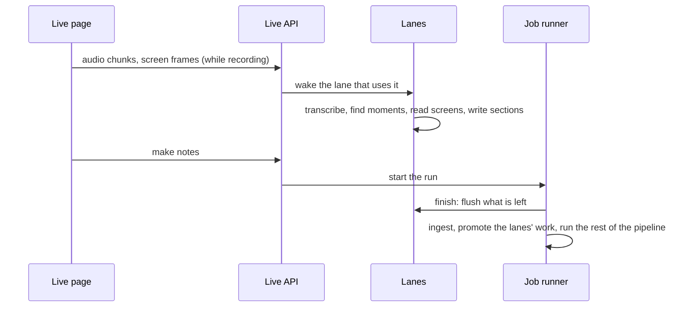
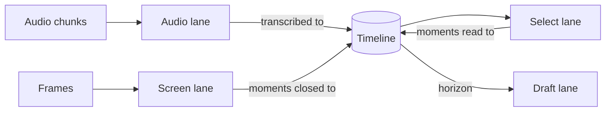

# Recording live

How Iris records a session as it happens, and does most of the note-making while it records,
so the notes are ready soon after the recording ends. The rest of the pipeline is in
[`making-notes.md`](making-notes.md).

## Key words

- **Audio chunk:** a few seconds of audio, posted as it is recorded. The chunks are numbered
  pieces of one WebM stream, so they join back into one recording.
- **Share:** one stretch of screen sharing (any number, or none); each frame carries its number.
- **Lane:** one part of the work done while recording: audio (the transcript), screen (the
  [moments](making-notes.md#key-words)), select (screen content, and redrawing its figures) and
  draft (notes sections). Each runs on its own with the stages' own steps and cache keys.
- **Transcript window:** a stretch of audio the audio lane transcribes in one call, cut at a quiet
  point.
- **Timeline:** where the lanes publish what they have finished, as **watermarks** (how far each
  has got). The **horizon** is the point before which nothing can change any more.
- **Pausing:** capture stops and the devices are let go; the recording can be continued.
- **Stopped:** a recording whose page went away; kept, but it can't be continued (the page held
  the recorder).
- **Make notes:** ending a recording and starting its run.
- **Promotion:** at make notes, the lanes' finished results are written as the stages' own
  outputs, so only what was still open is new work.

## The whole flow

The page captures and sends; the engine stores what arrives and lets the lanes work on it; make
notes turns what the lanes finished into the pipeline's own outputs and runs only the rest.

## Capturing in the page

1. The page opens the microphone and, in the desktop app, the Mac's sound; in a browser, a shared
   tab can bring its own sound. All of it is mixed into **one audio track**, recorded as audio
   chunks.
2. While the screen is shared, the page takes a still of it at a steady rate. Each frame is timed
   on the audio's clock and carries its share's number. With nothing shared, no frames are sent,
   so a recording can be audio only, or share and stop sharing any number of times.
3. Pausing pauses the recorder (its clock too, so the pause isn't in the recording), frames stop,
   and every device is let go. Continuing asks for the devices again and carries on in the same
   recording, under a new share if the screen comes back.
4. If the mic goes away or the recorder fails mid-recording, nothing more can be recorded, so the
   page makes notes from what it has.

*Why:* one mixed track keeps the audio a single recording on one clock, so screen and speech
always line up. Finding what changed on screen happens in the engine, so the page stays simple.

## Sending and storing

1. Chunks and frames go into an upload queue that posts a few at a time and retries a failed post
   with growing waits, through an outage or an engine restart.
2. The engine stores each as it arrives under the session's `live/` folder, keyed by its number
   (a chunk) or its time and share (a frame). A retry of a post that did land, or one that arrives
   out of order, lands in the same place, so nothing is lost or doubled.
3. Once the recording has ended, any further post is refused, so nothing is added after ingest
   has started.
4. Make notes waits until the queue is empty and tells the engine how many chunks there were. If
   some never arrived, the engine refuses and lists them; since every post has been answered,
   there is nothing to resend, so the page ends anyway and the missing audio becomes silence of
   the same length. Only the first chunk can't be replaced: it carries the stream's header.

*Why:* the captured files are the recording. The engine never changes them, so a session can
always be ingested again from them, whatever happened to the live work.

## The lanes and the timeline

Each arriving chunk or frame wakes the lane that uses it. The lanes never call each other: each
publishes what it has finished to the timeline and moves its watermark forward, and a lane that
needs another's work waits on that watermark.

- **Audio lane:** decodes the chunks in order as the one stream they are cut from, cuts the audio
  into transcript windows at quiet points, and transcribes them, each with the text before it as
  context. A cut depends only on the audio, never on how much had arrived, so a lane restarted
  after an engine restart makes the same cuts and reuses its cached windows.
- **Screen lane:** puts frames in time order, samples and sizes them exactly as ingest will, and
  feeds them to the same moment detector as the detect stage. A change of share closes the open
  moment. Before anything is shared, it simply keeps up with the transcript, so it never holds
  the notes back.
- **Select lane:** waits until the speech around a closed moment is transcribed, reads the moments
  in batches with the select stage's own step, and redraws each new figure in the background by
  the render stage's rules.
- **Draft lane:** packs everything before the horizon into notes sections exactly as the write
  stage would, and writes each one that can no longer change into the write stage's cache.

The **horizon** is the earlier of "transcribed to" and "read to": before it, the speech is
transcribed and every moment ending there has been read. Nothing published later can reach back
before it, so notes sections before it are final.

*Why:* using the stages' own steps and cache keys makes the live work the final work, not a draft
redone later. Lanes that only talk through the timeline can each fail, restart or wait without
the others knowing; a lane whose input lane failed stops making paid calls.

## Making notes and promotion

1. The run starts. The lanes flush what they still hold (the last window, the last moment, the
   remaining batches), then ingest writes the standard session files from `live/`. If the engine
   restarted since the recording (the desktop app quit and stopped it, say), no lanes are running:
   fresh ones start first and catch up from the captured files. Their caches make that quick and
   free, so only what was still open when recording stopped is paid for.
2. Promotion keeps the lanes' work as far as it holds together, in pipeline order. If the audio,
   screen and select lanes all finished cleanly, the transcript, moments, alignment and selection
   become the stages' outputs and the run goes on from write, where the sections written live and
   the figures redrawn live are cache hits. If only the audio lane did, the run goes on from
   detect, so the speech isn't transcribed twice. Otherwise (the audio lane failed or missed a
   chunk) the full pipeline runs, as for an upload.
3. The rest of the pipeline runs as usual. The time from make notes to finished notes depends on
   what was still open at the end, not on how long the session was (after a restart, plus a
   short catch-up that grows with the length of the recording).
4. Live processing can be turned off with a setting; a recording is then processed like an upload.

*Why:* live processing is best effort. The captured files stay the recording, so a lane that
fails costs time at make notes, never the session.

## When the page goes away

Notes cost money, so they are made only when asked for, or when the mic goes away and nothing
more can be recorded. The engine never ends a recording on its own.

1. If the page closes or reloads, it tells the engine to stop the recording: it is stopped and
   kept, and notes can be made from it later. If make notes was already chosen, it tells the
   engine to finish instead.
2. Leaving the Live page for another Iris page asks first and, if confirmed, does the same: it
   sends what is still waiting, then stops the recording and keeps it, so notes can be made from
   it in the library. If that can't finish (the engine isn't answering), the page stays and says
   so, and trying again keeps it, never makes notes.
3. In a browser, a recording carries on through an engine restart, its posts retried until they
   land.
4. In the desktop app, the app stops any recording its page left behind
   ([`desktop.md`](desktop.md#quitting-and-crashes)).

## Limits

- In a browser, a crash sends nothing, so the session stays recording until notes are made from
  its session page, or it is deleted.
- While the engine can't be reached for long, the oldest waiting frames are dropped to bound
  memory; audio never is, so the notes may miss what was on screen then.
- In a browser only Chrome has been checked with a real mic and screen share, and there is no Mac
  sound: on a Mac a browser shares a tab's sound at most.
- The last screen shown stays open until the next share or make notes, so a long stretch on one
  screen, or after sharing stops, is only read at make notes and finishes about as fast as an
  upload would.

## Where to look

- `frontend/src/capture/liveCapture.ts`: capture, chunks, frames, pause and continue, leaving
- `frontend/src/capture/uploadQueue.ts`: uploads and their retries
- `frontend/src/pages/LivePage.tsx`: the Live page
- `backend/src/iris/api/routes/live.py`: the live API
- `backend/src/iris/sources/browser_live.py`: how chunks and frames are stored and ingested
- `backend/src/iris/live/`: the processor, each lane (its docstring goes deeper), the timeline
  and promotion
- `backend/src/iris/live/replay.py`: plays a recording into a running engine to measure it; it
  makes real, paid calls, so use a scratch data folder ([`development.md`](development.md))
