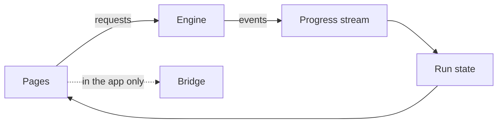

# The UI

The UI is a React app (TypeScript, Vite) in `frontend/`. The same code runs in a browser
(`make dev`) and inside the desktop app. It only talks to the [engine](overview.md#key-words)
over its HTTP API, so it never knows which one it is running in, except for the few things only
the app can do. Visual design (tokens, components, layout rules) is in
[`frontend/DESIGN.md`](../frontend/DESIGN.md).

## Key words

- **Library:** the home page: every session, with what can be done with each.
- **Session page:** one session: its progress while it is made, then its notes, figures and
  transcript.
- **Typed client:** API types generated from the engine's schema, so a call to a route or field
  that no longer exists fails the typecheck.
- **Action wrapper:** wraps a request so the page always gets an answer it can show and never
  stays stuck busy.
- **Run state:** what the session page shows, built up from the
  [progress stream](engine.md#key-words) by pure functions.
- **Notes editor:** editing the notes in place, saved as the session's
  [notes edits](engine.md#key-words).
- **Print sheet:** a print-only copy of the notes, drawn just for exporting a PDF, so the PDF
  looks like the notes and nothing on screen changes.
- **Bridge:** the few app-only functions the desktop app gives the page: change or remove the
  key, save a PDF, receive the menu bar's recording commands and tell it how the recording is
  going ([`desktop.md`](desktop.md)).

## How it works

The pages ask the engine for data and send it the user's actions; while a session is being made,
its progress stream feeds the run state, which the session page draws.

### The pages

There are five: the library, upload, live recording, a session, and settings. The router maps
each address to one page, and the top bar links them.

- The **library** lists sessions and offers what fits each one: open, delete, export a PDF,
  re-run a failed session (unless the recording itself was the problem, which a re-run can't
  fix), or make notes from a recording that was stopped. While any session is processing it
  refreshes itself, so their status stays current.
- **Upload** sends the file and shows how much has gone; once the engine has it, the page opens
  the new session ([`making-notes.md`](making-notes.md)). Cancel is offered only until the last
  byte is sent: the engine then makes the session anyway, so cancelling would only hide it.
- **Live** records and sends as it goes ([`recording-live.md`](recording-live.md)).
- The **session page** follows the run, then shows the notes, figures and transcript; the session
  can be renamed, re-run, deleted or exported from there.
- **Settings** saves the engine's settings and, in the app, reaches the key through the bridge.

Pages that hold unsaved work (the editor, Settings, a recording) ask before they are left.

### Talking to the engine

1. Every request goes to `/api/*` on the page's own address. In development Vite passes it on to
   the engine; in the app, the app handler forwards it with its token
   ([`desktop.md`](desktop.md)). So the page holds no engine address and no secret.
2. Most requests go through the typed client, and each of those through the action wrapper, so
   "the engine never answered" becomes an answer like any other and the button always comes
   back.
3. While only the engine is down, Vite or the app handler still answers, with a gateway error of
   its own. The engine never sends those, so the typed client treats them as no answer at all, and
   every page says Iris isn't responding instead of its own failure ("couldn't save", "couldn't
   delete").
4. A few requests can't use the typed client: an upload, which needs its progress; live capture,
   which sends raw audio and frames; the progress stream; and figure and file addresses, which
   are plain links. The upload, finishing a recording and discarding one read a gateway error the
   same way.

*Why:* one way to reach the engine, in both places, means one UI to build and test, and the
generated types catch a route that changed before anyone runs the page.

### Following progress

1. The session page loads the session, then opens its progress stream. The engine first replays
   its recent events for the session (since the engine started), then sends each new one as it
   happens.
2. Each event is applied to the run state by a pure function: a stage started or finished, a
   transcription chunk, a moment found, a figure redrawn, the run done or failed.
3. Applying an event twice changes nothing: every event is keyed (its stage, chunk or figure), so
   a replay after a reconnect lands on the same state. Events from an earlier run are ignored.
4. If the stream drops, the page reconnects and the replay fills the gap. If a session says it is
   processing but its stream stays silent, the page says the run was cut off and offers to resume
   it.
5. Only when the run is done does the page load the notes and the transcript. A re-run clears
   them at once, so notes from the last run are never shown as if they were new.

*Why:* the stream may replay, drop or arrive late, and keyed, pure steps make all three safe and
testable without a browser.

### Reading and editing notes

1. The notes arrive as Markdown in the [notes format](making-notes.md#the-notes-format). The
   reading view splits them into boxes, steps and figures, draws the rest as Markdown with KaTeX
   for maths, and puts each figure in from the session's files by its id. A block that can't be
   read as written is shown with a note saying why, instead of breaking the page.
2. The editor shows the same notes, editable in place: blocks can be added, turned into another
   kind, coloured and dragged. Each change is one step that Undo puts back.
3. Saving sends the whole edited Markdown, with a stamp of the generated notes it started from.
   The engine checks it and keeps it beside the generated notes; readers then get the edited
   version. Removing the edits goes back to the generated notes.
4. After a re-run the stamp no longer matches, so the edits are marked stale and the user
   chooses: keep their version, re-stamped against the new notes, or go back to the new notes.

*Why:* an edit never overwrites what Iris made, and a re-run never silently drops the user's work.
The UI and the engine read the notes format by the same rules, so what saves is what shows.

### Exporting a PDF

1. Exporting loads the session's notes and draws them in the print sheet, with the same component
   as the reading view, then waits for its figures and fonts.
2. The page is printed with a print stylesheet that shows the sheet alone.
3. In the app, the bridge asks where to save and writes the PDF there. In a browser, the browser's
   print dialog opens, where saving as a PDF is one choice.
4. The sheet is removed whatever happened. If it couldn't be drawn, nothing is printed, so the
   page underneath is never saved under the session's name.

*Why:* one component draws the screen and the PDF, so there is no second renderer to keep in
line, and exporting works from the library without opening the session.

### The bridge

In a browser the bridge is absent, and the pages leave out what needs it. Whether the page runs
in the app at all is told by the bridge being there, and nothing else. Whether a key is set
comes from the engine's settings, never from the app. They are read again whenever the window
regains focus, since the key can change from the app's menu, and a failed read is tried again a
few times, since the engine takes a few seconds to come back after a key change. The app's side
is in [`desktop.md`](desktop.md).

## Decisions

- **Logic in pure functions, pages thin.** The run state, the stream's connection, the notes
  format, the editor's block actions and drop spots, and the PDF steps are plain TypeScript,
  tested in plain Node with no browser.
- **Wording in one place.** What the pages say lives in `lib/messages.ts` and each page's own
  module; a failed run's message is one of a fixed list the engine owns, typed from the schema;
  raw error text is never shown.
- **Only the session's own figures are drawn.** An image the notes point at from anywhere else is
  blocked, since the notes are model output.
- **Cost in one format.** Costs are shown in one fixed format, not the browser's locale, so the
  rail and the library always agree. A total with unpriced calls is a lower bound: it says so and
  is rounded down, never up. Model and provider names never reach the page.
- **The theme before the first paint.** The page's HTML picks the theme before React starts, so
  a dark page never flashes white. Printing always uses the light colours.

## Limits

- What bypasses the typed client (step 4 of "Talking to the engine") isn't checked by the
  typecheck.
- The notes show only once the run is done; until then the session page shows progress.
- Live capture's browser limits are in [`recording-live.md`](recording-live.md#limits).

## Where to look

- `frontend/src/App.tsx`: the routes and the top bar.
- `frontend/src/api/`: the typed client, the generated `schema.d.ts`, the action wrapper `act()`
  (`request.ts`) and the bridge (`appBridge.ts`).
- `frontend/src/pages/`: one file per page.
- `frontend/src/session/`: run state (`state.ts`), the progress stream (`stream.ts`), upload, rename
  and the session page's parts (`ProgressRail.tsx` and the rest).
- `frontend/src/notes/`: the notes format (`format.ts`), the editor's logic (`editor/`), the
  reading view and the editor (`NotesView.tsx`, `NotesEditor.tsx`), and the PDF export
  (`PrintSheet.tsx`, `usePdfExport.tsx`, `printPdf.ts`).
- `frontend/src/components/`: the shared building blocks (`Icon.tsx`, `ConfirmDialog.tsx` and the
  rest).
- `frontend/src/lib/`: the wording (`messages.ts`), the formatters (`format.ts`) and what the notes
  views and the session page both know about figures and the outline (`notes.ts`).
- `frontend/src/hooks/`: the shared hooks (`useTitle.ts`, `useAskBeforeLeaving.ts`).
- `frontend/src/settings/`: the Settings page's logic, reading the settings (`useSettings.ts`),
  changing the key through the bridge (`useKeyChange.ts`) and the no-key warning
  (`NoKeyBanner.tsx`).
- `frontend/tests/`: the plain-Node tests.
